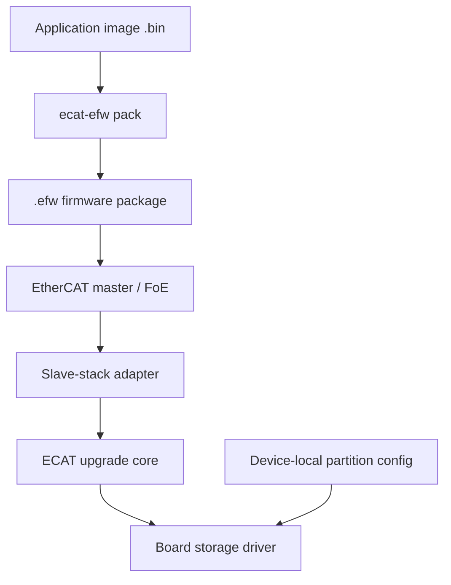

# ECAT

<p align="center"><strong>EtherCAT FoE firmware upgrade component · C99 · Standalone bootloaders for 32-bit MCUs</strong></p>

<p align="center">
  <a href="https://github.com/lckandyou-cmyk/ecat/actions/workflows/windows-cli.yml"></a>
  
  <a href="LICENSE"></a>
</p>

<p align="center">
  <a href="#quick-start">Quick start</a> ·
  <a href="#porting-to-an-mcu">Porting guide</a> ·
  <a href="#verification-status">Verification status</a> ·
  <a href="#reporting-issues">Report an issue</a>
</p>

> **Under development.** The core and SOES integration example pass host tests. Integration with a physical MCU board, protocol stack, and EtherCAT master has not been completed. This README distinguishes host-test evidence from work that still requires hardware validation.

ECAT provides a portable C99 upgrade core, an `.efw` firmware package parser, and target-storage driver interfaces for EtherCAT FoE upgrades. Integrators connect it to their own slave stack, board-level storage driver, and local partition configuration.

## Upgrade flow



The package carries project, hardware, target, and version metadata. **Write addresses and capacity limits come only from the device's local configuration.** ECAT does not include an EtherCAT stack or replace the MCU vendor's Flash driver and boot logic.

## Quick start

### Package and inspect firmware

Run `ecat-efw` with Python 3 from the repository root:

```sh
./ecat-efw pack \
  -i app.bin -n MY_PROJECT \
  -p 0x10010001 -d 1 -t MCU -v 1.0.0.0

./ecat-efw inspect MY_PROJECT_MCU_V1.0.0.0.efw
./ecat-efw info MY_PROJECT_MCU_V1.0.0.0.efw
./ecat-efw --version
```

`pack` wraps an existing `.bin` in an `.efw` package; it does not compile firmware. `inspect` prints detailed validation results, while `info` concisely shows the embedded firmware version, project and hardware IDs, target, payload size, and CRC results. Both identify packages by content, regardless of filename extension. The EFW format does not record a package build date; `--version` shows the CLI version and build date. Package validation does not establish device compatibility or bootability. Existing output files are not overwritten by default. Run `./ecat-efw --help` for all commands and options. CLI messages are currently in Chinese.

### Windows

The project builds a standalone Windows x64 CLI. Download the workflow artifact from [GitHub Actions](https://github.com/lckandyou-cmyk/ecat/actions/workflows/windows-cli.yml); tested prerelease tags such as `v0.1.0-alpha.N` publish a [prerelease](https://github.com/lckandyou-cmyk/ecat/releases). Python is not required on the target computer.

After extracting the archive, run this in PowerShell:

```powershell
.\ecat-efw.exe --help
```

The executable is unsigned and does not support `--overwrite`; specify an output path that does not already exist.

## Porting to an MCU

1. **Integrate the project and stack.** Add the core to a standalone bootloader and implement an adapter for the EtherCAT slave stack. An SOES example is included; third-party SOES/SSC source must be obtained separately.
2. **Configure device identity and partitions.** Set project ID, hardware ID, target type, storage base address, and capacity. Partition boundaries must come from local device configuration, never from the received firmware package.
3. **Implement the storage driver.** Provide initialization, image invalidation, erase, write, readback verification, finalization, and failure cleanup. Verify erase/write granularity and address boundaries.
4. **Validate on the target.** Use a physical MCU and EtherCAT master to verify success and failure paths, power-loss recovery, boot handoff, watchdog behavior, and timeouts.

Start with the [SOES bootloader example](examples/bootloader_soes/README.md) for interfaces, configuration, and integration steps. Its driver is an interface example, not a production-ready board implementation.

## Verification status

| Area | Verified | Not yet verified |
| --- | --- | --- |
| Upgrade core and `.efw` | Host unit tests with a simulated storage driver | Timing, Flash behavior, and power-loss recovery on a target MCU |
| SOES integration | Host tests using pinned upstream source files and hardware-port stubs | Full stack deployment and physical board/master integration |
| Beckhoff SSC | Synchronous adapter Mock contract tests; async gate tests | Real SSC integration and the complete asynchronous upgrade path |
| Windows CLI | Windows x64 workflow build and packaged CLI tests | Executable signing and coverage across target environments |

Passing host tests does not establish hardware or full protocol-stack validation. See the [SOES integration analysis](docs/architecture/soes-integration-options.md) for the test baseline, source hashes, and limitations.

## Security boundaries

- CRC32 in `.efw` detects accidental corruption; it does not authenticate firmware. Project and hardware IDs are not authentication credentials. Products requiring protection against malicious firmware must implement signature verification and a trust chain.
- Anti-rollback mode requires the target driver to implement `finalize_with_version_floor` as a power-fail-recoverable transaction that commits image activation and the version floor together. The core rejects configurations without this callback. Host mocks do not prove a board-specific transaction is power-fail safe.
- The SSC adapter checks the FoE access password. Its expected value defaults to `0`; configure a nonzero value before accepting WRQ requests when required. A FoE password is not cryptographic authentication.
- In the tested SOES version, the zero-length final-packet path may ignore a close-callback error. A final ACK alone is not evidence that the image was committed; integrators should provide an independent upgrade-result status.
- Native SOES filename matching has short-prefix and empty-name edge cases. If FoE read support is not needed, leave `FOE_READ_SUPPORTED` undefined; do not define it as `0`. See the [SOES integration analysis](docs/architecture/soes-integration-options.md).

## Documentation and feedback

- [EFW package format](docs/spec/efw-format-v0.1.md)
- [System architecture](docs/architecture/SAD-v0.1.md)
- [SOES integration analysis](docs/architecture/soes-integration-options.md)
- [SSC asynchronous stage note](docs/architecture/ssc-async-stage1.md)

Use the [bug report template](.github/ISSUE_TEMPLATE/bug_report.md) or [feature request template](.github/ISSUE_TEMPLATE/feature_request.md). Include the repository revision, MCU/board, stack version, master, compiler, and reproduction steps. Do not publish passwords, keys, credentials, or proprietary firmware.

## License

This project is licensed under the [MIT License](LICENSE). Third-party protocol stacks remain subject to their respective licenses.
