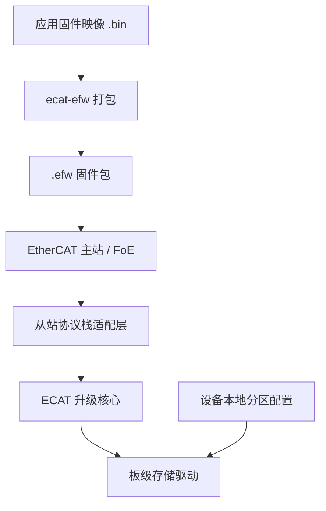

# ECAT

<p align="center"><strong>EtherCAT FoE 固件升级组件 · C99 · 面向 32 位 MCU 独立 Bootloader</strong></p>

<p align="center">
  <a href="https://github.com/lckandyou-cmyk/ecat/actions/workflows/windows-cli.yml"></a>
  
  <a href="LICENSE"></a>
</p>

<p align="center">
  <a href="#快速体验">快速体验</a> ·
  <a href="#移植到-mcu">移植指南</a> ·
  <a href="#验证状态">验证状态</a> ·
  <a href="#反馈问题">反馈问题</a>
</p>

> **研发阶段。** 核心和 SOES 接入示例已通过宿主测试；尚未在真实 MCU 板卡、协议栈和 EtherCAT 主站上完成联调。本文档区分已验证内容与待实机验证内容。

ECAT 提供 EtherCAT FoE 固件升级所需的通用 C99 核心、`.efw` 固件包解析器和存储驱动接口。集成者负责接入自己的从站协议栈、板级存储驱动与本地分区配置。

## 升级流程



固件包携带项目、硬件、目标和版本信息；**实际写入地址与容量只由设备本地配置决定**。ECAT 不包含 EtherCAT 协议栈，也不替代 MCU 厂商的 Flash 驱动或 Bootloader 启动逻辑。

## 快速体验

### 打包并检查固件

在仓库根目录使用 Python 3 运行 `ecat-efw`：

```sh
./ecat-efw pack \
  -i app.bin -n MY_PROJECT \
  -p 0x10010001 -d 1 -t MCU -v 1.0.0.0

./ecat-efw inspect MY_PROJECT_MCU_V1.0.0.0.efw
```

`pack` 将已有 `.bin` 封装为 `.efw`，不会编译固件；`inspect` 检查包结构和 CRC。项目 ID、硬件 ID、目标和文件名必须与设备端配置相符。默认拒绝覆盖已有输出。运行 `./ecat-efw --help` 查看全部参数。

### Windows

项目提供 Windows x64 独立 CLI。可在 [GitHub Actions](https://github.com/lckandyou-cmyk/ecat/actions/workflows/windows-cli.yml) 下载工作流产物；通过测试的 `v0.1.0-alpha.N` 等测试版标签会生成 [预发布 Release](https://github.com/lckandyou-cmyk/ecat/releases)。目标电脑无需安装 Python。

解压后在 PowerShell 中运行：

```powershell
.\ecat-efw.exe --help
```

Windows 可执行文件目前未签名，且不支持 `--overwrite`；请指定尚不存在的输出路径。

## 移植到 MCU

1. **接入工程与协议栈。** 将核心加入独立 Bootloader，并实现所用 EtherCAT 从站协议栈的适配。仓库包含 SOES 接入示例；SOES/SSC 第三方源码需自行获取。
2. **配置设备身份与分区。** 设置项目 ID、硬件 ID、目标类型、存储基地址和容量。分区边界必须来自设备本地配置，不能由收到的固件包指定。
3. **实现目标存储驱动。** 按介质实现初始化、失效标记、擦除、写入、回读校验、提交和失败清理，并验证擦写粒度与地址边界。
4. **在目标设备验证。** 使用真实 MCU 和主站验证升级成功与失败路径、断电恢复、启动交接、看门狗和超时行为。

从 [SOES Bootloader 示例](examples/bootloader_soes/README.md) 开始查看接口、配置和移植步骤。示例驱动用于展示接口，不是可直接用于产品的板级实现。

## 验证状态

| 范围 | 已验证 | 尚未验证 |
| --- | --- | --- |
| 升级核心与 `.efw` | 宿主单元测试；存储使用模拟驱动 | 目标 MCU 上的时序、Flash 行为与断电恢复 |
| SOES 接入 | 固定上游源码文件与硬件端口桩的宿主测试 | 完整协议栈部署、真实板卡与主站联调 |
| Beckhoff SSC | 同步适配器 Mock 契约测试；异步门控测试 | 真实 SSC 集成及完整异步升级路径 |
| Windows CLI | Windows x64 工作流构建与打包 CLI 测试 | 可执行文件签名与目标环境覆盖 |

宿主测试通过不等于硬件或完整协议栈验证。SOES 测试基线、文件哈希和限制见 [SOES 接入分析](docs/architecture/soes-integration-options.md)。

## 本地开发测试

需要 C99 编译器、Python 3、`make` 和 `pdftotext`：

```sh
make test CC=clang
make test-asan CC=clang
```

`make test-soes` 和 `make test-bootloader` 需要额外准备项目指定版本的 SOES 源文件。请按照 [示例文档](examples/bootloader_soes/README.md)中的提交号与哈希，将四个指定文件复制到独立目录后再运行。不要将完整 SOES 源码目录直接作为 `SOES_DIR`；其余头文件可能覆盖本仓库的宿主测试桩。此流程仍是宿主测试，不代表硬件验证。

## 安全边界

- `.efw` 中的 CRC32 用于检测意外损坏，不提供固件来源认证。项目 ID 和硬件 ID 也不是认证凭据；产品如需防恶意固件，必须另行实现签名验证和信任链。
- SSC 适配器会校验 FoE 访问密码。默认预期值为 `0`；如使用非零密码，须在接受 WRQ 前配置。FoE 密码不等同于密码学认证。
- 已测试的 SOES 版本在零长度结束包路径上可能忽略关闭回调错误，因此主站最终 ACK 不能单独作为镜像提交成功的证据。集成端应提供独立的升级结果状态。
- SOES 原生文件名匹配存在短前缀和空文件名边界问题。若不需要 FoE 读取功能，应保持 `FOE_READ_SUPPORTED` 未定义，而不是定义为 `0`。具体限制见 [SOES 接入分析](docs/architecture/soes-integration-options.md)。

## 规范与反馈

- [EFW 固件包格式](docs/spec/efw-format-v0.1.md)
- [系统架构说明](docs/architecture/SAD-v0.1.md)
- [SOES 接入分析](docs/architecture/soes-integration-options.md)
- [SSC 异步阶段说明](docs/architecture/ssc-async-stage1.md)

请通过 [Bug 报告模板](.github/ISSUE_TEMPLATE/bug_report.md)或[功能需求模板](.github/ISSUE_TEMPLATE/feature_request.md)提交反馈，并注明仓库版本、MCU/板卡、协议栈版本、主站、编译器和复现步骤。请勿公开密码、密钥、凭据或专有固件。

## 许可证

本项目采用 [MIT 许可证](LICENSE)。第三方协议栈须遵循其各自的许可条款。
