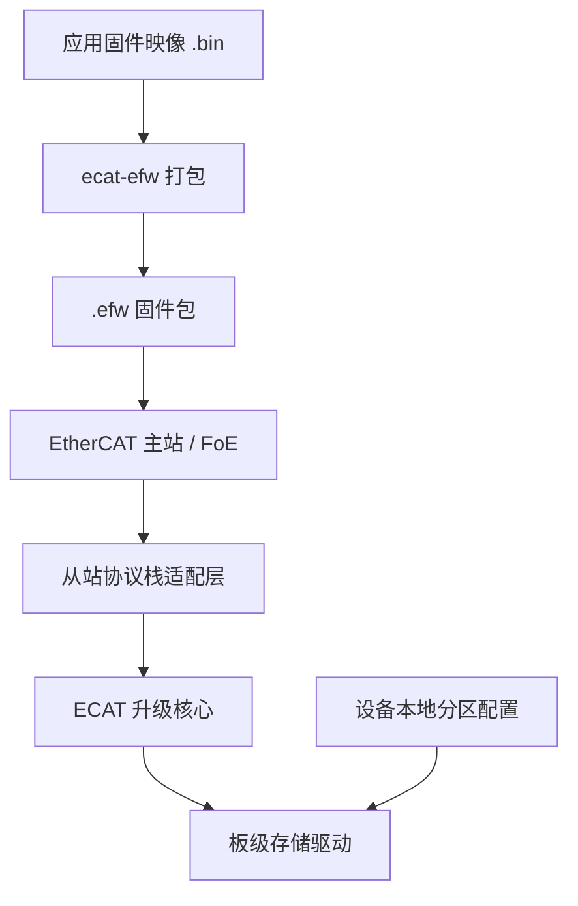

# ECAT

<p align="center"><strong>EtherCAT FoE 固件升级组件 · C99 · 面向 32 位 MCU 独立 Bootloader</strong></p>

<p align="center">
  <a href="https://github.com/lckandyou-cmyk/ecat/actions/workflows/windows-cli.yml"></a>
  
  <a href="LICENSE"></a>
</p>

<p align="center">
  <a href="#快速体验">快速体验</a> ·
  <a href="#移植到-mcu">移植指南</a> ·
  <a href="#验证状态">验证状态</a> ·
  <a href="#反馈问题">反馈问题</a>
</p>

> **研发阶段。** 核心和 SOES 接入示例已通过宿主测试；尚未在真实 MCU 板卡、协议栈和 EtherCAT 主站上完成联调。本文档区分已验证内容与待实机验证内容。

ECAT 提供 EtherCAT FoE 固件升级所需的通用 C99 核心、`.efw` 固件包解析器和存储驱动接口。集成者负责接入自己的从站协议栈、板级存储驱动与本地分区配置。

## 升级流程



固件包携带项目、硬件、目标和版本信息；**实际写入地址与容量只由设备本地配置决定**。ECAT 不包含 EtherCAT 协议栈，也不替代 MCU 厂商的 Flash 驱动或 Bootloader 启动逻辑。

## 快速体验

### 打包并检查固件

在仓库根目录使用 Python 3 运行 `ecat-efw`：

```sh
./ecat-efw pack \
  -i app.bin -n MY_PROJECT \
  -p 0x10010001 -d 1 -t MCU -v 1.0.0.0

./ecat-efw inspect MY_PROJECT_MCU_V1.0.0.0.efw
./ecat-efw info MY_PROJECT_MCU_V1.0.0.0.efw
./ecat-efw --version
```

`pack` 将已有 `.bin` 封装为 `.efw`，不会编译固件；`inspect` 输出详细校验信息，`info` 简洁显示包内版本、项目/硬件 ID、升级目标、签名状态、Key ID、固件大小和 CRC 结果。带 `--public-key` 时还会验证签名；否则只报告签名存在但未验证。命令按文件内容识别，不依赖扩展名。EFW 格式未记录打包日期；`--version` 显示 CLI 版本和构建日期。包校验不等同于目标设备兼容性或可启动性验证。默认拒绝覆盖已有输出。运行 `./ecat-efw --help` 查看全部命令和参数。

### 可选签名

默认仍生成未签名包。需要签名时，在可信打包环境准备 32 字节 Ed25519 私钥种子文件，并显式传入 `--signing-key`；签名/验签需要 PyNaCl 与 libsodium。CLI 不会把私钥写进 EFW，`--public-key-out` 可导出设备信任配置所需公钥。检查已签名包时，`info` 不带公钥只会显示“存在，未验证”；带 `--public-key` 才验证签名。Windows 发布 CLI 包含签名运行依赖。设备端验签接口默认关闭；启用时必须接入受保护公钥和验签后端，否则初始化失败，不会回退到未验证模式。

```sh
./ecat-efw pack -i app.bin -p 0x10010001 -d 1 -t MCU -v 1.2.3.4 \
  --signing-key signing-seed.bin --public-key-out trusted-key.bin -o app.efw
./ecat-efw info app.efw --public-key trusted-key.bin
```

不要提交、分发或记录私钥。签名功能默认关闭；设备要强制验签，必须在本地启用 `ECAT_FOE_SIGNATURE_VERIFY_ENABLE` 并接入受保护公钥及密码学后端。验签失败会拒绝升级，不会降级到未验证模式。当前解析器仅接受统一格式；旧格式固件需要重新打包。旧设备可能忽略未知扩展，不能靠签名包强制旧设备验签。

### Windows

项目提供 Windows x64 独立 CLI。可在 [GitHub Actions](https://github.com/lckandyou-cmyk/ecat/actions/workflows/windows-cli.yml) 下载工作流产物；通过测试的 `v0.1.0-alpha.N` 等测试版标签会生成 [预发布 Release](https://github.com/lckandyou-cmyk/ecat/releases)。目标电脑无需安装 Python。

解压后在 PowerShell 中运行：

```powershell
.\ecat-efw.exe --help
```

Windows 可执行文件目前未签名，且不支持 `--overwrite`；请指定尚不存在的输出路径。

## 移植到 MCU

1. **接入工程与协议栈。** 将核心加入独立 Bootloader，并实现所用 EtherCAT 从站协议栈的适配。仓库包含 SOES 接入示例；SOES/SSC 第三方源码需自行获取。
2. **配置设备身份与分区。** 设置项目 ID、硬件 ID、目标类型、存储基地址和容量。分区边界必须来自设备本地配置，不能由收到的固件包指定。
3. **实现目标存储驱动。** 按介质实现初始化、失效标记、擦除、写入、回读校验、提交和失败清理，并验证擦写粒度与地址边界。
4. **在目标设备验证。** 使用真实 MCU 和主站验证升级成功与失败路径、断电恢复、启动交接、看门狗和超时行为。

从 [SOES Bootloader 示例](examples/bootloader_soes/README.md) 开始查看接口、配置和移植步骤。示例驱动用于展示接口，不是可直接用于产品的板级实现。

## 验证状态

| 范围 | 已验证 | 尚未验证 |
| --- | --- | --- |
| 升级核心与 `.efw` | 宿主单元测试；存储使用模拟驱动 | 目标 MCU 上的时序、Flash 行为与断电恢复 |
| SOES 接入 | 固定上游源码文件与硬件端口桩的宿主测试 | 完整协议栈部署、真实板卡与主站联调 |
| Beckhoff SSC | 同步适配器 Mock 契约测试；异步门控测试 | 真实 SSC 集成及完整异步升级路径 |
| Windows CLI | Windows x64 工作流构建与打包 CLI 测试 | 可执行文件签名与目标环境覆盖 |

宿主测试通过不等于硬件或完整协议栈验证。SOES 测试基线、文件哈希和限制见 [SOES 接入分析](docs/architecture/soes-integration-options.md)。

## 安全边界

- `.efw` 中的 CRC32 用于检测意外损坏，不提供固件来源认证。项目 ID 和硬件 ID 也不是认证凭据。当前 EFW v2 提供默认关闭的 Ed25519ph 签名选项，准确覆盖范围见[格式规范](docs/spec/efw-format-v0.2.md)。
- 设备端验签只在本地显式启用并配置受信公钥及密码学后端时强制执行；签名错误、未签名包、算法或密钥不可用均拒绝，不降级。验签与防回滚独立，是否接受旧版本由本地防回滚策略决定。签名不能替代安全启动和镜像结构检查；单分区升级在最终验签前可能已擦除旧镜像，验签本身不保证断电恢复或设备可用。
- 启用防回滚时，目标驱动必须实现 `finalize_with_version_floor`，以断电可恢复事务联合提交镜像激活和版本下限；核心会拒绝缺少此回调的配置。宿主模拟不能证明具体板级事务的掉电安全。
- SSC 适配器会校验 FoE 访问密码。默认预期值为 `0`；如使用非零密码，须在接受 WRQ 前配置。FoE 密码不等同于密码学认证。
- 已测试的 SOES 版本在零长度结束包路径上可能忽略关闭回调错误，因此主站最终 ACK 不能单独作为镜像提交成功的证据。集成端应提供独立的升级结果状态。
- SOES 原生文件名匹配存在短前缀和空文件名边界问题。若不需要 FoE 读取功能，应保持 `FOE_READ_SUPPORTED` 未定义，而不是定义为 `0`。具体限制见 [SOES 接入分析](docs/architecture/soes-integration-options.md)。

## 规范与反馈

- [ECAT Wiki：快速开始、架构、移植与故障排查](https://github.com/lckandyou-cmyk/ecat/wiki)
- [EFW 固件包格式与签名规范](docs/spec/efw-format-v0.2.md)
- [旧 EFW v1 格式说明（历史）](docs/spec/efw-format-v0.1.md)
- [可选 Monocypher 设备端验签适配器](examples/crypto/README.md)
- [系统架构说明](docs/architecture/SAD-v0.1.md)
- [SOES 接入分析](docs/architecture/soes-integration-options.md)
- [SSC 异步阶段说明](docs/architecture/ssc-async-stage1.md)

请通过 [Bug 报告模板](.github/ISSUE_TEMPLATE/bug_report.md)或[功能需求模板](.github/ISSUE_TEMPLATE/feature_request.md)提交反馈，并注明仓库版本、MCU/板卡、协议栈版本、主站、编译器和复现步骤。请勿公开密码、密钥、凭据或专有固件。

## 许可证

本项目采用 [MIT 许可证](LICENSE)。第三方协议栈须遵循其各自的许可条款。
