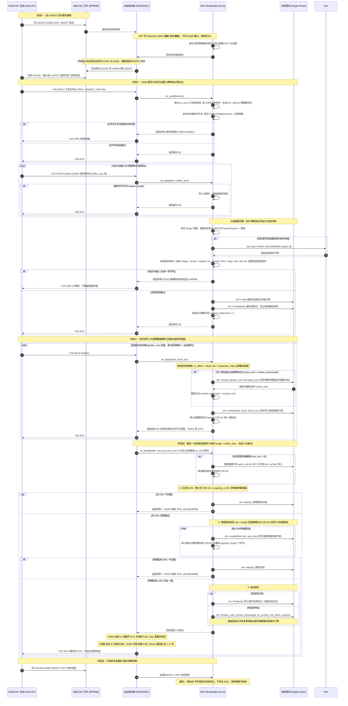

# 通用 EtherCAT FoE 固件升级库软件架构设计说明书 (SAD-v0.1)

---

## 1. 模块划分与边界职责

本库定位于纯 C 实现的轻量、解耦、通用 EtherCAT 从站升级中间件，运行于独立的 MCU Bootloader 工程中。划分为五个层次与模块：

```text
+-----------------------------------------------------------------------+
|                      用户工程 (Bootloader Main)                       |
+-----------------------------------------------------------------------+
        |                                                   |
        v                                                   v
+-----------------------+                         +---------------------+
|   FoE 适配接口 (薄转接) |                         | 目标驱动接口 (用户实现)|
|   (SSC / SOES Adapter)|                         | (APP / FPGA / EEPROM|
+-----------------------+                         +---------------------+
        | (on_wrq / on_data / on_end / on_abort)            | (生命周期调度)
        +--------------------------+------------------------+
                                   |
                                   v
+-----------------------------------------------------------------------+
|                     核心协议状态机 (Core Engine)                      |
|           - .efw 容器头三阶段解析与擦除前全量强校验                     |
|           - 严格物理分区边界约束 (禁止文件携带物理基地址)               |
|           - 同步阻塞调度、块粒度多收熔断、水位按需覆盖擦除 (erase_to)   |
|           - 驱动生命周期管理 (init/invalidate/erase_to/write/read)     |
|           - 双重校验防线: 流 CRC 比对 (抓传输) -> readback 比对 (抓存储)|
|           - 成功提交 (finalize) 与异常中止 (abort) 互斥调度             |
|           - 零动态内存分配 (无 malloc)                                 |
+-----------------------------------------------------------------------+
        ^                                                   ^
        |                                                   |
+-----------------------+                         +---------------------+
|  工程全局配置头 (Conf)  |                         | 平台适配与启动 (Port) |
|  (Project ID / 分区表) |                         | (跳转/复位/标志位/看门狗)|
+-----------------------+                         +---------------------+
```

### 1.1 各模块职责与边界

| 模块名称 | 职责 (Responsibility) | 边界与禁区 (Boundary & Non-Goals) | 规范状态 |
| :--- | :--- | :--- | :--- |
| **核心协议机 (Core)** | 维护 FoE 升级会话状态机；暴露 `on_wrq`、`on_data`、`on_end`、`on_abort` 四个纯事件接口；流式装配 `.efw` 文件头；执行文件名与文件头双向强交叉校验；执行“擦除前必须全过”检查；以回调块为粒度检测总长越界；维护擦除水位并调度 `erase_to`；分步调用驱动 `read` 并累加计算比对 CRC32；控制错误与熔断中止。 | **不包含**任何硬件寄存器读写；**不包含**任何特定协议栈私有数据结构；**不执行**动态内存申请 (`malloc`/`free`)；**不提供** FoE 读（RRQ）功能（v1 不支持，收到直接回复 `FOE_ERR_ACCESS`）。 | 【已确定】 |
| **FoE 适配接口 (Adapter)** | 作为协议栈与核心机的薄转接层；将 SSC 的 FoE 回调或 SOES 的前后置邮箱嗅探/中和钩子及 `foe_file_cfg_t` 回调映射到核心机的 `on_wrq`、`on_data`、`on_end`、`on_abort` 事件接口；解析 SOES 的 `buffer_size` 粒度并定界结束（注：真实 SOES 已接通前后置邮箱钩子并在宿主套件完成验证，真实 SSC 适配层目前仅完成接口抽象与 Mock 契约）。 | **不修改**官方协议栈内部状态机；**不越过**核心机直接操作底层驱动。 | 【已确定】 |
| **目标驱动接口 (Target Driver)** | 抽象各目标硬件（内部 Flash、外部 SPI Flash、ESC SII EEPROM、外部用户数据 EEPROM）的真实物理擦除、覆盖擦除（`erase_to`）、对齐写入、底层物理读取（`read`）、提交与中止操作。 | 仅由用户按硬件实现抽象函数指针；**不解析** FoE 协议；**不决定**写入基地址；**不负责** CRC32 算法计算。 | 【已确定】 |
| **全局配置头 (Config)** | 集中管理单一工程的 Project ID、Hardware ID、本地硬件版本 (uint16)、各目标使能宏开关、头部缓冲上限、Bootloader 硬编码分区物理基地址与最大限制尺寸。 | 仅提供静态宏定义常量；**严禁**运行时动态修改分区基地址。 | 【已确定】 |
| **平台适配层 (Port/Platform)** | 负责从 APP 切换至 Bootloader 的硬件/内存动作；管理 Retention RAM / RTC 备份域升级标记；提供各 Target 掉电安全防回滚版本下限存取；提供平台微秒延时与看门狗喂狗。 | 芯片专属逻辑（如 Cortex-M 内核寄存器操作），由用户针对特定 MCU 提供，**不入通用核心库**。 | 【已确定】 |

### 1.2 核心事件接口与协议栈适配映射机制

核心库对外仅暴露出四个纯 C 事件函数，适配层负责将其接入具体的 EtherCAT 从站协议栈：

```c
/* 核心协议机暴露的事件接口原型 (纯 C，无协议栈依赖) */
int ecat_foe_core_on_wrq(const char *filename, uint32_t filename_len, void *user_ctx);
int ecat_foe_core_on_data(const uint8_t *chunk, uint32_t chunk_len, void *user_ctx);
int ecat_foe_core_on_end(void *user_ctx);
void ecat_foe_core_on_abort(uint16_t error_code, void *user_ctx);
```

* **FoE 读请求 (RRQ) 规则【已确定】**：v1 规范明确不支持 FoE 读操作。若从站接收到 FoE RRQ 请求，适配层统一回复 `FOE_ERR_ACCESS` (`0x8002`)，核心机不暴露 `on_rrq` 接口。
* **两层结束判定机制【已确定，已核实】**：
  在从站协议栈与升级库架构中，必须明确区分两层结束判定：
  1. **底层 FoE 邮箱包级定界（SOES 内部）**：
     - 出处依据：`soes/esc_foe.c` 短包判定逻辑（当 `data_len < ESC_FOE_DATA_SIZE` 时进入尾包分支）以及 0 长度包分支（收到 `data_len == 0` 独立结束包）；
     - 行为：SOES 在内部判定传输完成并调用 `FOE_fclose()` 刷出缓冲区余量数据。
  2. **应用回调级定界（适配层使用）**：
     - 出处依据：`soes/esc_foe.c` 中 `FOE_fclose()` 内部调用 `foe_file->write_function` 刷出余量；
     - 判定规则：适配层以写入回调参数 **`length < foe_cfg->buffer_size`** 作为传输结束（EOF）的唯一定界依据。
       - 常规传输时：因 SOES 仅在 `fbuffer` 攒满时才回调（`esc_foe.c` 缓冲区满写入逻辑），传入长度恒等于 `foe_cfg->buffer_size`，适配层调用核心机 `on_data`；
       - 传输结束时：在 `FOE_fclose()` 内部传入的长度为缓冲区余量，严格满足 `length < foe_cfg->buffer_size`（若恰好对齐则长度为 0）。
* **`on_data` 允许 `chunk_len == 0`【已确定】**：
  - 核心语义：核心协议机显式支持 `chunk_len == 0`。当传入 `chunk_len == 0` 时，核心协议机直接将其视为传输结束定界符（EOF），并在内部自动触发完整的 `on_end` 校验与提交流程（包含补齐写入、流 CRC 比对、物理回读校验与 `finalize()` 标记有效）；
  - 适配层定界简化：适配层在 `write_function` 回调中，当 `length < foe_cfg->buffer_size` 时（无论 `length > 0` 还是 `length == 0`），均可直接调用 `ecat_foe_core_on_data`。若 `length == 0`，核心自动触发结束流程闭环；若 `length > 0`，适配层在送入尾块后亦可显式调用 `ecat_foe_core_on_end()`。
* **0 长度包分支 `FOE_fclose` 返回值被 SOES 忽略的处理策略【已确定】**：
  - **源码出处与事实**：查阅 `soes/esc_foe.c` 0 长度包结束分支逻辑（详见 `soes-integration-options.md` 中已登记引文 Q2_ESC_FOE_ZERO_LEN_CLOSE）：
    在该分支中，SOES 执行 `FOE_fclose()`、`res = FOE_send_ack()` 与 `FOE_init()`，但 `FOE_fclose()` 的返回值（即 `write_function` 回调的返回值）被**完全忽略**，SOES 未对返回值做任何检查，直接执行 `FOE_send_ack()` 向主站回复成功 ACK 并通过 `FOE_init()` 重置状态机（对比短包分支中明确检查了返回值 `if ((ncopied != data_len) || FOE_fclose ())`）。
  - **空包路径出现条件**：独立 0 长度包只在传输总字节数（`header_length + payload_length`）**恰好等于底层 FoE 数据包单包容量（`ESC_FOE_DATA_SIZE`）的整数倍时才会出现**；这纯粹属于以太网 FoE 协议层分包规则，**与应用层配置的 `foe_cfg->buffer_size` 缓冲大小完全无关**。（注：TwinCAT 等主流主站在整倍数时实际下发 0 长度包的行为标记为 **【未核实】**）。
  - **架构决策【已确定】**：v1 架构确定**完全接受此限制，不给 SOES 打源码补丁**。
  - **安全性保证（防变砖）**：
    由于架构在首包解析通过后已强制调用目标驱动的 `drv->invalidate()`，固件就绪/有效标记已提前被清除。即使最后一次回调内的校验或提交失败、且主站误收到了成功 ACK，底层介质中依然处于无效标记状态。设备后续软复位或冷启动时，Bootloader 启动检查判定固件无效并拒绝引导，设备常驻在 Bootloader 中等待重新升级，降低变砖风险（前提为底层存储擦写具备掉电原子性且 Bootloader 引导前置有效性校验完整）。
  - **缓解措施 1（主机打包端避开空包路径）**：
    打包工具新增可选参数 `--foe-packet-size N`（例如 512 字节），若计算出 `header_length + payload_length` 恰好是 $N$ 的整数倍，自动在有效负载末尾追加适量 `0xFF` 填充字节（若为 SII 目标则追加 2 字节整倍数），使得总长避开 $N$ 的整倍数，从源头上规避空包路径。填充的字节完全计入 `payload_length` 与 `payload_crc32`。**注意：这是主机端的尽力而为缓解手段，不作为理论保证**，因为不同主站现场配置的实际 FoE 单包分包大小标记为 **【未核实】**。
  - **缓解措施 2（从站状态机 BOOT→INIT 切换拦截报错）【已核实钩子存在、能改写目标状态并设置 AL 错误码；效果待真机验证】**：

    **源码事实（`esc.c`）**：
    - `as = (uint8_t)((ac << 4) | (as & 0x0f));`——将 AL Command（主站请求态）移入高 4 位，当前 AL Status（当前态）保留低 4 位，合并为迁移码。
    - `pre_state_change_hook` 在此时调用，位于 `switch(as)` **之前**。此时 `*as` 为合并后的迁移码（`BOOT_TO_INIT` 即 `0x13`），`*an` 为当前 AL Status 值。
    - `switch(as)` 随后执行，进入 `case BOOT_TO_INIT:` 分支，执行 `ESC_stopmbx()` 并将 `an = ESCinit;`——**此赋值在 `switch` 内部，会无条件覆盖 pre 钩子对 `*an` 的修改**；pre 钩子无法阻止 `switch` 内的迁移处理，也无法阻止邮箱被停止。
    - `post_state_change_hook` 在整个 `switch` 处理（含 `ESC_stopmbx()`）之后调用，此时邮箱已停。

    **拦截方案（基于以上源码分析）**：

    - **pre 钩子（拦不住迁移，不采用）**：
      源码证明 `pre_state_change_hook` 在 `switch` 前调用，但 `case BOOT_TO_INIT:` 中 `an = ESCinit;` 会覆盖 pre 钩子对 `*an` 的改写，`ESC_stopmbx()` 也必然执行。**pre 钩子无法保持邮箱可用、无法阻止 `switch` 内的迁移处理**，不适合在此拦截状态切换。

    - **post 钩子（可改写最终结果，但邮箱已停）【待真机验证】**：
      `post_state_change_hook` 在 `switch` 完成之后调用，此时 `ESC_stopmbx()` 已执行。Hook 内修改 `*an` 与调用 `ESC_ALerror()` 的结果将在后续由 `ESC_ALstatus(an)` 写入 `0x130 AL Status`。拦截步骤：
      1. Hook 检测到 `*as == BOOT_TO_INIT`（`0x13`）且适配层拦截条件满足（如“最后提交失败”或会话未正常闭环）；
      2. 改写目标状态：`*an = ESCboot | ESCerror;`（`ESCboot = 0x03`，`ESCerror = 0x10`）；
      3. 调用 `ESC_ALerror(ALERR_NOVALIDFIRMWARE);`（`0x0014`），向 `0x134 AL Status Code` 写入固件无效错误码；
      4. SOES 因 `an & ESCerror` 置位跳过清错，通过 `ESC_ALstatus(an)` 将错误状态写入 `0x130`；
      5. **后果**：主站收到状态切换被拒绝，AL Status 停留在 BOOT+Error，AL Status Code 为 `0x0014`。**此时邮箱已停，主站只能看到错误码后重新走 INIT→BOOT 发起升级**（不能直接重试 WRQ）。
      6. SSC 侧 `post_state_change_hook` 等效机制标记为 **【未核实（未读到 SSC 源码）】**。
* **栈层中止通知缺口与会话自愈机制【已确定】**：
  - 源码出处：`soes/esc_foe.c` 中 `FOE_abort()` 函数实现。
  - 源码事实：SOES 协议栈在遭遇通信错误（如包序号错、超时、或主站下发 FoE ERR）进入 `FOE_abort` 路径时，仅发送 ERR 包并调用 `FOE_init()` 重置自身，**不会调用应用层回调函数（既不调用 `write_function`，也无任何 abort 钩子）**。
  - 影响与后果：核心协议机无法实时收到 `on_abort` 通知，导致核心机产生未闭环的会话状态残留（仍处于写状态），底层目标驱动的 `drv->abort()` 也不会在协议栈中止的瞬间被调用。
  - **安全底线保证**：由于架构上在首包擦除前已强制调用了 `drv->invalidate()`，固件区已被标记为无效状态，保障在 Bootloader 前置校验完备且存储介质掉电不损坏标记的前提下，防止误引导半途损坏的固件。
  - 恢复与自愈规则：
    1. **新会话清理规则（强保证）**：核心机在每次 `ecat_foe_core_on_wrq` 的入口处，必须首先检查当前会话状态。若检测到上一个会话尚未正常闭环（处于非 IDLE 残留状态），核心机必须立即主动调用当前已绑定驱动的 `drv->abort(drv->user_ctx)` 释放驱动资源，随后将核心机的所有状态机与内部上下文重置为初始状态，再继续处理新的 WRQ 请求；
    2. **状态感知兜底规则（尽力保证）**：若适配层或 Bootloader 主循环能够感知到从站离开了 BOOT 状态（例如监听到 AL Control 离开 BOOT 或总线复位），应主动显式调用 `ecat_foe_core_on_abort()`，通知核心机清理残留会话。
* **回调返回值语义【已确定，已核实】**：
  - 规范约定：回调函数（`write_function`）返回 `0` 表示成功；返回**任意非零值**表示失败；
  - 源码事实：查阅 `soes/esc_foe.c` 中写入回调返回值检查与 `FOE_abort` 错误处理逻辑。SOES 仅检查返回值是否非零，不解析具体错误码数值。
* **SOES 与核心机内存缓冲约束【已确定】**：
  1. **配置参数获取**：SOES 适配层必须获取当前工程配置的 `foe_cfg->buffer_size`，核心接口保持不变；
  2. **整倍数对齐约束**：SOES 的 `foe_cfg->buffer_size` **必须配置为各已启用目标 `write_unit` 的公倍数**（如片内 Flash 为 8 字节、SPI Flash 为 256 字节，则 `buffer_size` 须为 256 整数倍，如 512 或 1024 字节）；
  3. **有效负载对齐与残留缓冲**：核心维护一个残留缓冲，大小为配置项 `ECAT_FOE_MAX_WRITE_UNIT`（各启用目标 `write_unit` 的最大值）；头剥离后的有效负载起点不一定对齐，残留字节在此累积，凑满一个 `write_unit` 再下发驱动写入；不另做整块二次复制，避免在 MCU 紧张的 RAM 中维护双份数据缓冲。
* **SSC 协议栈映射规则**：SSC 侧的回调粒度与内存聚合机制标为 **【未核实（未读到 SSC 源码）】**。

---

## 2. APP→Bootloader 切换架构（主线方案 A 与兼容方案 B）

> **前置硬件结论**：
> 1. 基于 LAN9252 官方手册 [pdf:PDF_Q2_RST_PIN_RESET] 核实结果，ESC 的复位引脚（`RST#`）拉低会触发全芯片复位（包括以太网 PHY 掉线与 EEPROM 重载）。
> 2. 已拍板决策：**硬件设计上 ESC 复位脚由 MCU 独立 GPIO 单独控制，严禁与 MCU NRST 引脚直连**。主线采用方案 A（MCU 硬件复位系统重启）；方案 B 仅作为历史旧板（复位脚直连）的纯软件内存跳转备选兼容方案。

```text
主线方案 A (MCU 独立 GPIO 控制 ESC 复位，外部上拉隔离):
  APP 收到 INIT->BOOT -> 不确认 BOOT -> 写 Retention RAM 标志 -> NVIC_SystemReset() -> Bootloader 启动 (检测到标志: 禁止触碰 ESC 复位脚) -> 启动协议栈 -> 栈自身接管 BOOT 并写 0130h 确认

兼容方案 B (历史旧板复位脚直连，无法使用硬件复位):
  APP 收到 INIT->BOOT -> 不确认 BOOT -> 写 Retention RAM 标志 -> 关全局中断+停外设 -> 纯内存跳转 Bootloader 入口 -> 硬件重初始化 (禁止触碰 ESC 复位脚) -> 启动协议栈 -> 栈自身接管 BOOT 并写 0130h 确认
```

### 2.1 Bootloader 启动与复位控制规则【已确定】

#### 1. 切换握手核心原则【已确定】
* **禁止通用库与 Bootloader 直接操作 ESC AL Status**：
  APP 在收到 `INIT -> BOOT` 请求（AL Control 寄存器 `0120h-0121h` 为 `3h`，见 [pdf:PDF_Q3_AL_CONTROL_REG]）时，**严禁向 ESC AL Status 寄存器 (`0130h-0131h`，见 [pdf:PDF_Q4_AL_STATUS_REG]) 确认 BOOT**，仅在保留 RAM 中写入暖切换标志，随后立即跳转进入 Bootloader。
* **由协议栈自行接管并确认**：
  Bootloader 启动后，先检测并清除暖切换标志，然后初始化 EtherCAT 从站协议栈（SSC / SOES）。由协议栈自身的初始化逻辑或状态机轮询检测 ESC 中挂起的 BOOT 请求，并由协议栈自行向 AL Status 写入 `3h: Bootstrap State`（见 [pdf:PDF_Q4_AL_STATUS_REG]）完成握手响应。通用升级库核心与用户驱动**严禁直接写 ESC 0130h 寄存器**。
* **待验证与未核实事项**：
  - MCU 硬件复位后，ESC 内部寄存器与邮箱 SM（SyncManager）配置是否能够完好保留、从站协议栈启动后能否无缝接上当前待处理的 BOOT 请求标为 **【待验证】**。
  - SSC 协议栈在未确认状态下重启接管的具体行为标为 **【未核实（未读到 SSC 源码）】**。

#### 2. 暖启动标志结构与清除时机【已确定】
* **双校验字结构**：
  暖切换标志必须存放在未初始化 Retention RAM（或 RTC 备份寄存器）中，采用“魔数 + 取反魔数”双重校验格式：
  - `boot_magic == 0x544F4F42U`（ASCII 字符 `'BOOT'` 的小端表示）；
  - `boot_magic_inv == 0xABB0B0BDU`（即 `~0x544F4F42U`）。
* **读后立即清除**：
  Bootloader 在读取并校验该标志后，**必须在第一时间将其全盘清零**。防止因后续异常复位导致 Bootloader 误判陷入死循环。

#### 3. 启动来源判定优先级【已确定】
Bootloader 启动后，必须按以下严格优先级判定执行流向：
1. **优先级 1：暖切换判定（Warm Transition）**：
   - **条件**：检测到保留 RAM 中 `boot_magic == 0x544F4F42U` 且 `boot_magic_inv == 0xABB0B0BDU`。
   - **行为**：立即清除标志；**严格禁止触碰 ESC 复位 GPIO**；**严格禁止重新初始化会打断 PDI 通信的外设**；初始化 PDI 接口；启动从站协议栈接管 BOOT 状态机；常驻 Bootloader 等待主站 FoE 下发。
2. **优先级 2：冷启动默认安全行为（Cold Boot）**：
   - **条件**：未检测到标志、标志全 0、数据损坏或反码校验不一致。
   - **行为**：一律按冷启动流程处理：
     - 允许 MCU 通过独立 GPIO 对 ESC 执行硬件复位，确保 ESC 处于上电初始状态；
     - 检验本地 APP 固件区的有效性标志与 CRC32 校验和；
     - 若 APP 固件合法有效：在预设窗口（如 50ms）后立即跳转运行 APP；
     - 若 APP 固件损坏或不存在：停留在 Bootloader，启动从站协议栈并维持基础网络通信，等待主站救砖。

### 2.2 方案 A：主线架构（MCU 独立 GPIO 控制 ESC 复位）

* **硬件设计前提【待硬件确认，通用经验，非手册内容】**：
  ESC 的 `RST#` 引脚与 MCU 独立控制 GPIO 之间，必须设计有外部硬件物理上拉电阻。
  - **原理**：MCU 进入系统复位期间，所有 GPIO 通常处于浮空输入（高阻态）。依靠外部强上拉电阻（经验值通常为 4.7kΩ 至 10kΩ），确保 ESC 的 `RST#` 全程稳定维持在高电平，不产生负脉冲下冲，杜绝 ESC 发生非预期复位。
* **真机示波器验证点**：
  1. 示波器通道 1 挂 MCU `NRST`，通道 2 挂 ESC `RST#`，在 APP 执行 `NVIC_SystemReset()` 瞬间抓取波形，确认 MCU 复位时 ESC `RST#` 引脚全程稳定在高电平，无任何负脉冲与电压跌落；
  2. 测量 MCU 在复位高阻期间该 GPIO 引脚电平幅值与纹波，验证上拉电阻能够有效抵御总线耦合噪声；
  3. 示波器抓取以太网 PHY Link 信号或网口状态 LED，确认在 MCU 硬件复位全周期内，以太网链路持续 Link Up，TwinCAT 主站不报掉线或通信中断。

### 2.3 方案 B：兼容备选架构（历史旧板 MCU NRST 与 ESC RST# 直连）

* **适用场景**：已投产的历史旧版硬件，ESC 复位引脚被直连至 MCU 外部复位总线，MCU 软复位必然导致外部引脚拉低并连带复位 ESC。
* **切换流程（纯软件安全内存跳转）**：
  1. APP 收到 AL Control 寄存器（`0120h-0121h`）请求 `3h: Request Bootstrap State`，在 Retention RAM 写入“魔数 + 取反魔数 (`0xABB0B0BDU`)”，**不确认 BOOT**；
  2. APP 立即执行全盘系统反初始化：
     - 关闭全局中断：`__disable_irq()`；
     - 完全停止并关闭所有已使能外设（DMA 通道、定时器、PDI/SPI 控制器）；
     - 停止并清零 SysTick 计数器；
     - 按目标 MCU 实现的 IRQ 数量，使用 NVIC `ICER` 禁用外部中断，并使用 `ICPR` 清除挂起状态；`ISER` 是置使能寄存器，不可用于清除使能位；
  3. 按具体 Cortex-M 器件及启动实现设置 Bootloader 向量表基址，并读取、检查向量表中的初始 MSP 与 Reset_Handler；若应用可重定位向量表，应在任何可能启用中断之前配置；
  4. 由目标专用、不可返回的汇编跳转桩完成交接：在切换 MSP 前先准备好 MSP 与 Reset_Handler，随后设置 MSP 并直接分支到 Reset_Handler。不得在普通 C 函数中调用 `__set_MSP()` 后继续执行函数调用或函数指针跳转；还需按具体内核处理 CONTROL、栈限制寄存器等状态；
  5. Bootloader 启动，执行硬件重初始化（时钟树重置、GPIO 模式重设、SPI/PDI 控制器全新初始化、ESC 中断事件清零），**禁止触碰 ESC 复位 GPIO**，启动协议栈，由协议栈接管待决 BOOT 请求。
* **潜在风险**：
  1. 外设残留风险：未完全停止的 DMA、定时器若在跳转后触发非法中断，将引发 HardFault；
  2. PDI/SPI 事务悬停：中途跳转可能导致 ESC 端 SPI 状态机死锁；
  3. ESC 中断残留（IRQ Pin）：未清除中断可能引发中断风暴；
  4. 假定默认状态的风险：Bootloader 跳过部分寄存器配置可能引发不可预期行为。
* **真机验证点**：
  1. 示波器抓取 MCU `NRST` 引脚电平，验证纯软件跳转全过程完全平直；
  2. 示波器抓取 SPI 片选（CS）与时钟（SCK），验证跳转瞬间总线释放为空闲状态；
  3. 示波器抓取 ESC 硬件中断引脚（IRQ），验证跳转前后及 Bootloader 初始化后中断响应；
  4. 寄存器状态回读验证：Bootloader 启动初期回读关键寄存器，验证全部干净重设；
  5. 连续多次跳转压力测试，验证反复触发切换无 HardFault 与通信挂死。

---

## 3. 升级流程时序规范



### 3.1 时序关键设计准则

1. **【已确定】擦除前必须全过与分阶段装配**：
   文件头可能跨多次协议栈回调块。在头部全部字节攒齐并通过 `header_crc32` 与全量元数据安全检查前，**核心机仅对中间块返回 0 成功，严格禁止调用驱动的 `init`、`invalidate`、`erase_to`、`write` 或 `read` 接口**。若校验失败，直接返回非零触发 FoE ERR，原有固件完整无损。
2. **【已确定】失效标记先行 (Invalidate)**：
   在开始擦除物理扇区前，驱动层必须先调用 `invalidate()` 清除目标固件的就绪/有效标记。一旦升级中途断电或意外中止，下次冷启动时 Bootloader 能准确识别固件损坏，杜绝执行未烧录完整的半成品代码。
3. **【已确定】同步阻塞模型与按需覆盖擦除 (erase_to)**：
   - **同步阻塞执行本质**：在原生 SOES 协议栈架构中，`write_function` 回调完全在主循环上下文单线程同步执行。`erase_to` 扇区擦除、对齐写入、回读校验以及 `finalize` **全部在当前回调函数内部同步执行完毕**，不存在让渡 CPU 控制权去服务周期通信的机制；“分步”仅代表核心机控制单次内存缓冲的粒度（如 4KB）；
   - **主站超时硬性约束**：在同步阻塞模型下，**每一次回调的总执行耗时必须严格小于主站单包请求超时时间**（主站超时数值标为 **【未核实】**）。利用 `erase_to` 将整分区擦除切散为按需单扇区擦除（通常数十毫秒【经验值，大扇区不成立】），是避免单次回调超时的关键；
   - **机制实现**：在 `invalidate()` 执行完毕后，核心机维护内部写入水位 `erased_watermark`；当数据块到达需要写入某物理偏移且超出当前水位时，核心调用 `drv->erase_to(need_end, &erased_end)`。驱动自行负责擦除覆盖到 `need_end` 所需的所有扇区，并返回实际已擦除到的物理边界 `erased_end`。扇区大小与具体物理划分完全由驱动负责，核心不关心。
4. **【已确定】双重校验职责分工机制**：
   系统通过两道防线严格区分“网络通信故障”与“硬件存储故障”：
   - **第一道防线：流 CRC 比对（Stream CRC Check）**：核心机在数据接收过程中，对送达的所有有效 Payload 数据字节增量累加 IEEE 802.3 CRC32；在最后一次回调中首先比对流 CRC32 与文件头 `payload_crc32`。此步专门用于快速抓取以太网通信误码、丢包或截断；若不匹配，直接中止，无需执行耗时的底层读回；
   - **第二道防线：物理介质回读校验（Readback CRC Check）**：流 CRC 比对通过后，核心机调用驱动 `drv->read` 逐块读回已写入物理 Flash/EEPROM 的真实数据并重新计算 CRC32 与文件头比对。此步专门用于排查 Flash 坏块、物理写入电压抖动、擦除不全等硬件存储缺陷。
5. **【已确定】块粒度多收熔断检测**：
   在流式接收过程中，核心机以回调块为粒度持续检测累计接收偏移；当某一次回调数据使得 `rx_offset + block_len > Expected_Total` 时，**核心机立即整块拒绝，不再写入任何物理数据，并直接返回错误触发中止熔断**。
6. **【推断，未验证】Bootloader 启动时主动比对 0120h 与 0130h 及 AL Control 事件联动**：
   - **问题推断与机理【推断，未验证】**：APP 在检测到 `INIT -> BOOT` 请求时通常会读取 AL Control 寄存器（`0120h`）。
   - **手册依据**：依据 LAN9252 官方手册 [pdf:PDF_Q6_AL_EVENT_CLEAR_PDI]，Bit 0 为 AL Control Event，其注释注明：`This bit is cleared by reading the AL Control Register from PDI.`。证实 PDI 读取 0120h 时硬件会自动清除 0220h 寄存器中的该事件标志。
   - **协议栈源码事实**：查阅 SOES 源码中 `ESC_state()` 函数实现（详见 `soes-integration-options.md` 中已登记引文 Q9_ESC_C_ESC_STATE_ALEVENT_CHECK）：
     函数通过检查 `if (ESCvar.ALevent & ESCREG_ALEVENT_CONTROL)`（0220h Bit 0）判定是否有待处理状态转换；若该标志位未置位，直接执行 `return;` 退出，根本不会主动读取 `0120h`。
   - **设计要求**：若 APP 先前读取 0120h 导致硬件自动清除了 0220h 事件位，Bootloader 启动的新协议栈轮询时将无法感知待决请求。设计上要求 Bootloader 在协议栈初始化后，需保证挂起的 BOOT 状态转换能够被正常触发处理。
   - **触发办法候选（只评估不实现）**：
     1. *候选方案 1（置位事件标志）*：在协议栈初始化完成后，由适配层通过原生符号显式设置 `ESCvar.ALevent |= ESCREG_ALEVENT_CONTROL;`，引导下一次主循环轮询自然进入 `ESC_state()`；
     2. *候选方案 2（直接调用状态处理）*：在外部检测到 `0120h == 0x0003` 且 `0130h != 0x0003` 时，直接显式调用 `ESC_state()`；
     3. *候选方案 3（主动写入确认）*：由适配层调用 `ESC_ALstatus(ESCboot);` 主动完成状态确认。
     *评估结论：上述 3 项候选方案目前仅作为架构评估，通用核心库与适配层暂不实现任何侵入逻辑，待真实硬件主站环境联调实测确认后再行决策。*
   - **真机验证点**：
     1. TwinCAT 主站下发 INIT->BOOT 状态转换指令；
     2. APP 记录暖启动标志并软复位进入 Bootloader；
     3. 示波器抓取 SPI PDI 交互报文，确认从站协议栈能否在 0220h 事件位已清零情况下稳定响应并进入 BOOT 状态。
7. **【建议，待验证】升级成功后的重启走暖切换（专用标志值）**：
   - **时机判定【已确定，待真机验证】**：固件写入与校验成功后，由主站发起从 BOOT 到 INIT 的状态转换请求（`BOOT -> INIT`，依据 Infineon 官方范例工程说明）。
   - **暖切换重启规则【建议，待验证】**：Bootloader 捕获到切回 INIT 状态后，建议在 Retention RAM 中写入专用的“固件升级成功就绪”魔数（如 `0x55504752U`，即 ASCII `'UPGR'`，及其取反码 `0xAAAFB8ADU`），调用 `NVIC_SystemReset()` 软复位系统进入 APP，**全程不拉低 ESC 复位 GPIO**。
   - **理由与冷启动代价**：若执行冷启动硬件复位 ESC，ESC 内部 PHY 将被迫掉电重启导致以太网链路掉线（Link Down），TwinCAT 主站会立刻报通信中断或从站拓扑丢失；而走暖切换可保持 ESC 供电与链路全程 Link Up，主站能无缝检测到从站重新在 INIT 态就绪，避免网络抖动。
8. **【已确定】新会话清理规则与栈层中止通知缺口自愈**：
   - **通知缺口成因**：查阅 SOES 源码 `esc_foe.c` 中 `FOE_abort()` 函数实现，处理错误时直接重置协议栈并向主站回 ERR 包，不调用任何应用层写入钩子。因此从站核心协议机无法收到栈层主动下发的 `on_abort` 事件；
   - **安全底线保证**：虽然核心机状态机产生残留，但由于首包解析通过后已提前调用了 `drv->invalidate()`，固件区已处于无效标记保护中，即使异常中断也不会变砖；
   - **核心自愈动作**：核心协议机在每次 `ecat_foe_core_on_wrq` 入口处强制执行清理检查：若发现上一次会话仍处于未闭环残留状态（如写状态），立即主动调用当前驱动的 `drv->abort()` 释放资源，并将核心上下文完整重置；同时，若适配层或主循环能够感知到从站退出 BOOT 状态，亦应主动调用 `ecat_foe_core_on_abort()` 提前释放驱动。

### 3.2 完整 FoE 错误码映射表与 SOES 协议栈限制

本库定义的标准错误码严格取自 EtherCAT 规范（依据 `soes/esc.h` 标准错误码定义）。核心机内部完整保留细分错误枚举供本地诊断日志使用。在与原生 SOES 协议栈对接时，已确定采纳**候选 A：接受原生 SOES 错误码下发限制，不要求用户给 SOES 打补丁**：

| 错误码常量 (`soes/esc.h`) | 数值 | 错误定义类别 | 本库理论触发场景与失败原因 | SOES 适配层实际回给主站 |
| :--- | :--- | :--- | :--- | :--- |
| `FOE_ERR_NOTFOUND` | `0x8001` | 文件不存在/未找到 | WRQ 阶段文件名项目名与本地 `ECAT_FOE_PROJECT_NAME` 不符；目标字样不存在或在本地未启用 (`ENABLE_TARGET_x == 0`)。 | 见下方限制说明：原生 SOES 在调用 `on_wrq` 前已向主站发送 ACK(0)，WRQ 阶段拒绝无法直接下发，只会在首块数据阶段转为 `0x800B`【宿主 harness 观察】 |
| `FOE_ERR_ACCESS` | `0x8002` | 访问被拒绝/权限不足 | 收到 FoE RRQ 读请求（本库不支持读操作）；首包文件头与本地 Hardware ID 不符；本地硬件版本不在 `[hw_ver_min, hw_ver_max]` 区间；文件名与文件头字段交叉比对不一致。 | 数据阶段收敛为 `0x800B` |
| `FOE_ERR_DISKFULL` | `0x8003` | 介质已满/容量溢出 | `payload_length` 超过本地静态配置的分区容量上限 (`ECAT_FOE_xxx_MAX_SIZE`)；或回调块累加超过 64 位期望总长（多收溢出即时熔断）。 | `0x800B` (数据阶段收敛) |
| `FOE_ERR_ILLEGAL` | `0x8004` | 非法报文/参数格式错误 | 文件名格式不对（无法逆向切分、非 .efw 后缀或版本格式错误）；魔数错误 (`magic != 0x57464345`)；格式版本不支持 (`format_version != 1`)；头部长度非法（<64、>本地上限或非 4 倍数）；保留标志位非零 (`flags != 0`)；`reserved` 区非全 0；版本倒置 (`hw_ver_min > hw_ver_max` 或 `min_allow_version > fw_version`)；防回滚开启时 `port_get_version_floor` 失败或触发版本倒退拦截。 | 数据阶段收敛为 `0x800B` |
| `FOE_ERR_PACKETNO` | `0x8005` | 数据包包号错误 | FoE 数据包包号错乱或丢包（由协议栈底层检出）。 | `0x8005` (协议栈底层回复) |
| `FOE_ERR_PROGERROR` | `0x800B` | 介质编程/校验失败 | 目标驱动硬件操作失败（`init`、`erase_to`、`write`、`read`、`finalize` 返回错误）；主站传输超时；传输中途物理断开。 | `0x800B` (原生支持) |
| `FOE_ERR_CHECKSUM` | `0x800C` | 校验和/CRC 不匹配 | `header_crc32` 校验不匹配；流 Payload CRC32 不匹配；物理回读比对 CRC32 不匹配。 | `0x800B` (数据阶段收敛) |

* **防回滚持久化错误处理与时序规则【已确定】**：
  1. **目标身份先验**：调用 `port_get_version_floor` 前，核心必须验证包头 `target_id` 范围和本地使能状态，并确认包头 `target_id`、`fw_version` 与已解析的 WRQ 一致；无效目标信息不得传给端口回调；
  2. **防回滚开启时获取失败**：若 `port_get_version_floor` 返回非零，核心机在阶段 3 直接拒绝升级（回复错误，驱动不调用 `init`/`erase_to`）；
  3. **联合提交时机**：防回滚开启时，目标驱动必须提供 `finalize_with_version_floor`；核心在数据和回读校验通过后仅调用该回调，由板级实现以断电可恢复事务联合提交镜像激活与版本下限。不得以先后调用 `finalize()` 和 `port_set_version_floor()` 冒充事务；
  4. **失败语义**：联合提交回调返回非零时，候选镜像不得激活、已提交下限不得改变，核心调用 `abort()` 并返回 `ANTI_ROLLBACK_UPDATE`。复位恢复时也不得出现“新镜像有效但仍使用旧下限”的状态。事务日志和启动恢复由板级实现负责，并需在目标硬件验证；
  5. **版本语义**：联合提交实现必须再次核对当前持久化下限，拒绝低于该下限的候选版本，并以 `max(当前下限, 包头 min_allow_version)` 作为新下限，保证下限单调不减。

> **SOES 协议栈限制依据【已核实】**：
> 查阅 SOES 源码 `esc_foe.c`，在数据写入与结束阶段，只要 `write_function` 返回非零，SOES 内部固定调用 `FOE_abort (FOE_ERR_PROGERROR)`。因此在原生 SOES 环境下，从站无法向主站区分并回复 `0x800C`、`0x8003`、`0x8002` 或 `0x8004`，只能回复单一的 `0x800B`。适配层接受此限制，细分错误通过从站本地日志/串口记录。
>
> **SOES WRQ 阶段拒绝不可见限制【宿主 harness 观察】**：
> 查阅 SOES 源码 `esc_foe.c` 并经宿主测试 harness 验证，SOES 在 `FOE_write()` 收到 WRQ 报文时，仅比对 `foe_cfg` 文件名列表，匹配成功即直接回复 ACK(0)，期间不调用任何用户回调或 `on_wrq`。因此若文件名校验在核心机应用层判定不通过，由于 ACK(0) 已提前发出，WRQ 阶段的拒绝在原生 SOES 下发不出去，只会在首块数据到达触发 `write_function` 时返回非零，由 SOES 发送 `0x800B (FOE_ERR_PROGERROR)` 中止。
>
> **0 长度包分支返回值忽略限制与拦截策略【已确定】**：
> 查阅 SOES 源码 `esc_foe.c` 0 长度包分支，当传输结束由独立 0 长度包触发时，SOES 调用 `FOE_fclose()` 后根本未检查其返回值，直接回复 `FOE_send_ack()`。因此，若升级失败发生在 0 长度包触发的最后一次回调中（如 Stream CRC 或 Readback CRC 不符），从站无法通过 FoE 回调向主站回复 `0x800B`。v1 架构确定接受此限制，依靠 `invalidate()` 保证不引导破损固件，并通过打包端末尾填充避开空包，以及在适配层通过 `post_state_change_hook` 在主站发起 `BOOT -> INIT` 状态切换时拦截并设置 AL Status Code `0x0014 (ALERR_NOVALIDFIRMWARE)`（详见第 1.2 节）。

### 3.3 FOE_OP_BUSY 机制与阻塞模型语境说明

* **出处定义**：`soes/esc.h` 宏定义 `#define FOE_OP_BUSY 6`。
* **协议栈现状说明**：
  - **SOES【已核实】**：查阅 SOES 源码 `esc_foe.c`，函数 `static void FOE_busy ()` 仅在使能了 `FOE_READ_SUPPORTED` 且状态处于 `FOE_WAIT_FOR_ACK`（即从站响应读请求等待主站 ACK）时调用；在写请求（WRQ）与数据包接收路径中，官方源码未内建从站主动发送 BUSY 的现成接口。SOES 写入侧目前**完全没有从站写 BUSY 机制**。
  - **SSC【未核实】**：SSC 协议栈写入侧是否存在从站发 BUSY 机制标记为 **【未核实（未读到 SSC 源码）】**。
* **架构语境澄清【已确定】**：
  “交还控制权服务协议栈、发送 FoE BUSY 报文拖住主站”的运行机制，**仅在适配层或协议栈支持延迟/异步处理时可用**；在原生 SOES 协议栈下，该机制完全不可用，从站必须遵循纯同步阻塞模型，单次回调最长耗时必须依赖 `erase_to` 压制在主站单包超时阈值之内。

---

## 4. 目标全部可选的配置与驱动接口约定

### 4.1 全局配置约定 (`ecat_foe_conf.h`)

通过纯宏常量与接口定义实现目标全部可选与物理边界隔离。基地址与尺寸均为示例，移植到具体硬件时修改此文件：

```c
#ifndef ECAT_FOE_CONF_H
#define ECAT_FOE_CONF_H

#include <stdint.h>
#include <stdbool.h>

/* 工程与硬件身份识别 */
#define ECAT_FOE_PROJECT_ID                 0x10010001U
#define ECAT_FOE_PROJECT_NAME               "SERVO_DRV"
#define ECAT_FOE_HARDWARE_ID                0x00000001U
#define ECAT_FOE_LOCAL_HW_VER               0x0001U      /* 本地硬件版本号 (uint16，与 efw 头的 hw_ver_min/max 一致) */

/* 头部装配缓冲上限 (必须 >= 64 字节且为 4 的倍数) */
#define ECAT_FOE_HEADER_BUF_MAX             128U

/* 目标升级使能开关 (全部可选，默认只开 APP) */
#define ECAT_FOE_ENABLE_TARGET_APP          1  /* 目标 1: APP 固件 (字样: MCU) */
#define ECAT_FOE_ENABLE_TARGET_FPGA         0  /* 目标 2: FPGA 镜像 (字样: FPGA) */
#define ECAT_FOE_ENABLE_TARGET_SII_EEPROM   0  /* 目标 3: ESC SII EEPROM (字样: SII，高危默认严格关闭) */
#define ECAT_FOE_ENABLE_TARGET_USER_EEPROM  0  /* 目标 4: 外部用户数据 EEPROM (字样: EEPROM，默认关闭) */

/* 防版本回滚开关 (已拍板：默认关闭) */
#define ECAT_FOE_ANTI_ROLLBACK_ENABLE       0

/* 容灾分区策略 (已拍板：默认单分区覆盖，A/B 双分区可选) */
#define ECAT_FOE_DUAL_BANK_ENABLE           0

/* 写入物理对齐单位 (字节，按具体硬件 Flash 特性配置，如 4、8、256) */
#define ECAT_FOE_APP_WRITE_UNIT             8U
#define ECAT_FOE_FPGA_WRITE_UNIT            256U
#define ECAT_FOE_SII_WRITE_UNIT             2U
#define ECAT_FOE_USER_EEPROM_WRITE_UNIT     4U

/* 严格物理分区表 (只认本地硬编码，不信任文件携带地址。以下均为【示例，非规范数值】) */
#define ECAT_FOE_APP_BASE_ADDR              0x08020000U  /* 示例基地址 */
#define ECAT_FOE_APP_MAX_SIZE               (384U * 1024U)

#define ECAT_FOE_FPGA_BASE_ADDR             0x00100000U  /* 示例基地址 */
#define ECAT_FOE_FPGA_MAX_SIZE              (1024U * 1024U)

#define ECAT_FOE_SII_EEPROM_MAX_SIZE        (4U * 1024U) /* ESC SII 物理配额上限 */

#define ECAT_FOE_USER_EEPROM_BASE_ADDR      0x00000000U  /* 示例基地址 */
#define ECAT_FOE_USER_EEPROM_MAX_SIZE       (8U * 1024U)

/* 文件名目标字样与 Target ID 映射表定义 */
typedef struct {
    const char *name_str;  /* 目标字样 (禁止含下划线) */
    uint16_t target_id;    /* 对应的 Target ID */
} ecat_foe_target_map_t;

/* 映射表规范定义 (已确定: MCU, FPGA, SII, EEPROM) */
static const ecat_foe_target_map_t g_target_name_map[] = {
    { "MCU",    0x0001U },
    { "FPGA",   0x0002U },
    { "SII",    0x0003U },
    { "EEPROM", 0x0004U },
    { NULL,     0x0000U }
};

/* 防回滚版本下限读取接口 (启用时由 Platform/Port 实现)。 */
int port_get_version_floor(uint16_t target_id, uint32_t *floor_ver);
/* 独立写入仅供平台管理；核心升级提交不调用此函数。 */
int port_set_version_floor(uint16_t target_id, uint32_t new_floor_ver);

#endif /* ECAT_FOE_CONF_H */
```

### 4.2 目标驱动接口草案 (`ecat_foe_target.h`)【草案】

目标驱动是用户对接实际物理存储介质的纯 C 函数指针集合。该接口定义为【草案】。**分区容量只认本地静态配置 `ECAT_FOE_xxx_MAX_SIZE`，驱动不暴露容量**。

#### 1. 驱动生命周期调用时序
驱动接口的调用严格遵循以下先后次序（全流程在回调内部同步完成）：
$$\text{init} \longrightarrow \text{invalidate} \longrightarrow [\text{erase\_to (按需)} \ / \ \text{write}]^* \longrightarrow \text{流 CRC 比对} \longrightarrow [\text{core: read \& crc32}]^* \longrightarrow \text{finalize 或联合提交}$$
* **异常处理**：若上述任何一步返回失败、或传输超时、或主站中途断开，流程立即转向调用 `abort()`。
* **互斥规则**：普通模式的 `finalize()` 或防回滚模式的 `finalize_with_version_floor()` 与 `abort()` 严格互斥，一次升级会话必然且仅能执行其中之一。

#### 2. 接口函数签名与规范约定

```c
typedef struct ecat_foe_target_driver {
    /* 1. 初始化存储介质 */
    int (*init)(void *user_ctx);

    /* 2. 置无效标记 (擦除前调用，防止掉电误判) */
    int (*invalidate)(void *user_ctx);

    /* 3. 按需擦除到指定结束偏移 (驱动自行负责扇区划分与擦除，返回实际已擦到的物理边界) */
    int (*erase_to)(uint32_t need_end, uint32_t *erased_end, void *user_ctx);

    /* 4. 对齐分块写入 (直接写入底层介质，无二次聚合) */
    int (*write)(uint32_t offset, const uint8_t *data, uint32_t len, void *user_ctx);

    /* 5. 物理介质底层读取 (核心分步调用并计算 CRC32，SII 读回比对亦复用此接口) */
    int (*read)(uint32_t offset, uint8_t *buf, uint32_t len, void *user_ctx);

    /* 6. 成功提交 (仅在全部传输且校验无误后调用，写有效标/切换分区) */
    int (*finalize)(void *user_ctx);

    /* 7. 中止清理 (失败、超时或断开时调用，锁定硬件、保持无效) */
    void (*abort)(void *user_ctx);

    /* 8. 防回滚模式的断电可恢复镜像/版本下限联合提交 */
    int (*finalize_with_version_floor)(uint16_t target_id,
                                       uint32_t fw_version,
                                       uint32_t min_allow_version,
                                       void *user_ctx);
} ecat_foe_target_driver_t;
```

#### 3. 各接口具体职责与生命周期清理契约【已确定】
* **驱动生命周期与清理契约 (核心严格保证)**：
  1. **`init` 失败清理责任**：若 `init()` 自身执行失败并返回非零，表示驱动初始化未完成，由驱动内部自行负责清理未完成的半成品资源；核心状态机不调用 `abort()`。
  2. **`init` 成功后异常清理责任**：一旦 `init()` 成功返回 0，驱动生命周期会话正式激活。此后发生的任何后续失败（包括 `invalidate`、擦除、写入、校验、普通 `finalize` 或防回滚联合提交失败，以及协议栈/主站中途中止），核心机均保证调用且仅调用一次 `abort()`。
  3. **提交成功后互斥保护**：`finalize()` 或 `finalize_with_version_floor()` 成功后，同一会话内不再调用 `abort()`；若后续收到新 WRQ 请求，可开启新会话。

1. `init`：
   - 触发时机：头部装配完成且“擦除前必须全过”检查全部通过后调用；
   - 职责：解锁 Flash 控制器、建立外设通信、校验供电状态。返回 0 成功，非 0 失败（失败由驱动内部清理，核心不调 `abort`）。
2. `invalidate`：
   - 触发时机：`init` 成功后、执行任何擦除动作之前调用；
   - 职责：在物理介质中清除该目标的“有效/就绪”标志。保证在此刻之后的任何掉电事故下，重启时 Bootloader 均视该目标为损坏无效，绝不盲目引导。返回 0 成功，非 0 失败。
3. `erase_to`（按需覆盖擦除）【建议，待验证】：
   - 触发时机：数据流写入偏移超出核心机维护的当前擦除水位时同步调用；
   - 职责：入参 `need_end` 为当前必须覆盖到的字节偏移。驱动自行根据底层 Flash 扇区组织（无论扇区大小是否均匀），擦除覆盖到 `need_end` 所需的所有扇区，并通过 `*erased_end` 输出实际擦除完成的物理边界。核心机更新自身水位，后续落入该水位的写入直接执行。扇区大小与划分完全由驱动负责，核心不关心。成功返回 0，硬件出错返回 -1 并转入 `abort`；
   - 耗时约束：单次回调同步阻塞执行，擦除耗时必须严格控制在主站单包超时阈值之内。
4. `write`：
   - 触发时机：分包流式传输时在回调内同步调用；
   - 写入对齐规范：核心机将送达的对齐块数据直接调用 `write` 写入底层介质；
   - 末尾对齐填充规则：传输结束时若有效数据不是 `write_unit` 的整数倍，核心机在末尾填充 `0xFF` 补齐至整对齐块下发；**计算 Payload CRC32 时严格仅覆盖原始有效字节，填充的 0xFF 不计入 CRC32 计算范围**。
5. `read`（物理介质底层读取与核心分步 CRC 计算）：
   - 触发时机：流 CRC 比对成功后，在最后一次回调内部同步循环调用；
   - 职责：驱动仅负责将物理存储介质中指定偏移和长度的数据读入缓冲 `buf`。由核心机分步调用 `read` 并增量计算 IEEE 802.3 CRC32，**校验范围严格仅覆盖 `payload_length` 个有效字节**；
   - **风险说明【重点提示】**：最后一次回调必须等待核心同步回读全部完成且 CRC32 比对无误后才能返回 0 发送最终 FoE ACK。若目标是挂载在外部低速 SPI 总线上的 SPI Flash（如 1MB 至 4MB 的 FPGA 镜像），全片物理回读耗时较长，存在突破主站单包超时的风险（架构决策定为最后一次回调内同步完成，详见 5.1 节第 13 条；实测耗时列入 open-issues 跟踪）。
6. `finalize`：
   - 触发时机：流 CRC 与物理回读 CRC32 均比对成功后同步调用；
   - 职责：向非易失存储写入固件有效标记、更新向量跳转表、或切换 A/B 活动分区元数据。函数无参数，仅在完全成功时调用。返回 0 成功，非 0 失败；
   - 互斥契约：`finalize()` 成功后，同一会话内不再调用 `abort()`；防回滚模式改走 `finalize_with_version_floor()`，成功后同样进入已提交状态。
7. `abort`：
   - 触发时机：`init()` 成功后发生的任何元数据核验失败、驱动任一接口返回错误、FoE 传输超时、主站中途断开连接时调用；
   - 职责：锁定存储控制器、释放外设总线、清除临时写入数据，确保候选镜像处于明确的“无效状态”。与成功提交回调严格互斥，且一次会话至多执行 1 次。

### 4.3 ESC SII EEPROM 专项设计规范

#### 1. 严重风险说明【已确定】与推断说明【推断】
* **默认配置关闭**：`ECAT_FOE_ENABLE_TARGET_SII_EEPROM` 必须默认严格置 `0`。
* **风险与推断说明**：
  ESC 的 SII (Slave Information Interface) EEPROM 存放着 ESC 上电硬件配置与 ESI 数据。
  依据 LAN9252 手册 EEPROM 控制/状态寄存器【未核实（未纳入自动化核验清单）】，若 EEPROM 镜像写入损坏或校验失败，上电时 ESC 寄存器将报错：Bit 11 `Checksum Error in ESC Configuration Area` 为 1，Bit 12 `EEPROM Loading Status` 为 1。
  **工程推断【推断】**：虽然手册只给出了上述状态位，但依据从站硬件行为特性，ESC 此时将处于错误挂起状态，无法正常响应主站进入 BOOT 状态，主站亦无法通过网络恢复通信。依赖标准 BOOT/FoE 的 MCU Bootloader 网络恢复路径将完全失效，设备完全变砖，必须拆机使用物理夹具重新烧录物理 EEPROM。

#### 2. MCU 通过 PDI 访问 SII EEPROM 的机制【未核实（未纳入自动化核验清单）】
* **0500h 寄存器**：
  - 出处：LAN9252 手册 EEPROM CONFIGURATION REGISTER（偏移 `0500h`，【未核实】）；
  - Bit 0：`PDI EEPROM Control`；说明：`1: Yes (PDI has EEPROM control)`。
* **0501h 寄存器**：
  - 出处：LAN9252 手册 EEPROM PDI ACCESS STATE REGISTER（偏移 `0501h`，【未核实】）；
  - Bit 0：`Access to EEPROM`。
* **PDI 控制 EEPROM 规则**：
  - 出处：LAN9252 手册 EEPROM PDI ACCESS 规则说明（【未核实】）；
  - 说明：`Otherwise, PDI controls the EEPROM interface.`。
* **0502h-0503h 寄存器**：
  - 出处：LAN9252 手册 EEPROM CONTROL/STATUS REGISTER（偏移 `0502h-0503h`，【未核实】）；
  - Bit 15：`Busy`；说明：`1: EEPROM interface is busy`；
  - Bit 14：`Error Write Enable`；
  - Bit 13：`Error Acknowledge/Command`；
  - Bit 12：`EEPROM Loading Status`；
  - Bit 11：`Checksum Error in ESC Configuration Area`；
  - Bits 10:8 命令：`Command Register`；说明：`010: Write`；`100: Reload`。
* **0504h-0507h 寄存器**：
  - 出处：LAN9252 手册 EEPROM ADDRESS REGISTER（偏移 `0504h-0507h`，【未核实】）；
  - 寻址单位：`Bit 0: First word (16-bit)`。
* **0508h-050Bh 寄存器**：
  - 出处：LAN9252 手册 EEPROM DATA REGISTER（偏移 `0508h-050Bh`，【未核实】）；
  - 数据读写：`EEPROM Read/Write Data`。

#### 3. SII 校验字的位置与算法【未核实】
* **核实状态**：**【未核实】**。
* **核实依据说明**：
  LAN9252 官方手册 EEPROM CONTROL/STATUS REGISTER【未核实】定义了状态位 `Checksum Error in ESC Configuration Area`，但**手册全文未给出 ESC Configuration Area 校验字存放的具体 Word 地址（如 Word 7）以及校验和的具体累加/反转算法**。该项标记为【未核实】，待查实 ETG 官方规范后补充。

#### 4. 新内容何时生效【未核实（未纳入自动化核验清单）】
* **手动重载命令**：向 `0502h-0503h` Command Register 写入 `100: Reload`（见 LAN9252 手册 EEPROM CONTROL/STATUS REGISTER【未核实】），可触发 ESC 重新从 EEPROM 读取数据。
* **特定功能限制（仅限 Enhanced Link 与 MI Link）**：
  - 依据 Note 11（LAN9252 手册 EEPROM 链路检测配置注释【未核实】），说明仅在上电复位后首次 EEPROM 加载时生效（该限制仅针对 Enhanced Link detection）；
  - 依据 Note 27（LAN9252 手册 EEPROM 寄存器注释【未核实】），说明仅在上电复位后首次 EEPROM 加载时生效（该限制仅针对 MI link detection）；
  - 手册仅明确指出上述两项链路检测特性在手动 reload 时不会生效，**不能外推为全部寄存器或通用 Reload 规则**。

#### 5. 写入 SII 前的防御校验项【已确定】
为防御误刷导致变砖，在允许写入 SII EEPROM 之前，Bootloader 必须实施以下确定规则：
1. **Target ID 严格匹配【已确定】**：容器头中的 `target_id` 必须严格等于 `0x0003`；
2. **Payload 长度严格偶数与容量约束【已确定】**：`payload_length` 必须为偶数（Word 16 位对齐）且 `<= ECAT_FOE_SII_EEPROM_MAX_SIZE`；
3. **写入后全片/写入区域逐字读回校验 (Read-back Verify)【已确定】**：每写入一个 Word，通过 PDI Read 命令逐字读回比对；写完整体后，调用驱动的 `read` 接口整体回读并计算 CRC32 进行比对；
4. **Bootstrap 邮箱段与 SII Checksum 校验【暂缓】**：检查镜像中 Bootstrap 邮箱配置段（字偏移 0x14-0x17、0x1C bit3 标为【未核实（ETG.2010 待查实）】）及 SII Checksum 算法预校验暂缓实施，待后续查实标准规范后再行补充。

### 4.4 外部用户数据 EEPROM 专项设计规范【已确定】
* **纯驱动抽象隔离**：
  外部用户数据 EEPROM（Target 4）挂载于 MCU 自有外设总线（如 MCU I2C1 / SPI2），用于保存设备标定数据、出厂配置或应用层参数。ESC 无法直接访问此器件。
* **通用库边界**：
  本通用库对其仅作标准驱动函数指针抽象（`init`, `invalidate`, `erase_to`, `write`, `read`, `finalize`, `abort`），不引入任何特定芯片型号（如 24C02、24LC64 等）的寄存器或操作时序，完全由用户按硬件实现。

---

## 5. 架构决策同步与待决策清单

### 5.1 已拍板决策（已定稿同步）

1. **【已确定】文件头格式**：采用固定 64 字节基础长度，包含 `format_version` 与 `header_length` 字段，Header CRC32 固定放置于头最后 4 字节，支持向前兼容跳过未知扩展字段。
2. **【已确定】版本号与防回滚**：固件版本采用 32 位数值型表示；防版本回滚做成编译宏开关（`ECAT_FOE_ANTI_ROLLBACK_ENABLE`），默认严格保持关闭（`0`）；若开启，按 Target ID 独立保存版本下限，升级成功后持久化更新。
3. **【已确定】容灾分区策略**：默认采用单分区直接覆盖模式，依靠常驻且物理隔离的独立 MCU Bootloader 提供盲救保障；A/B 双分区做成可选宏配置（`ECAT_FOE_DUAL_BANK_ENABLE`）。
4. **【已确定】切换架构主备线**：ESC 复位引脚由 MCU 独立 GPIO 控制并配外部上拉，方案 A（MCU 硬件复位重启）作为官方主线架构；方案 B（纯软件安全内存跳转）降为兼容历史复位脚直连旧板的备选。
5. **【已确定】EEPROM 双目标支持**：将 ESC SII EEPROM（Target 3）与 外部用户数据 EEPROM（Target 4）拆分为两个完全独立的目标，各自具备独立的使能开关与驱动接口，其中 SII EEPROM 默认严格关闭。
6. **【已确定，待真机验证】升级成功后的系统复位时机与方式**：
   - 固件写入与校验成功后，由主站发起从 BOOT 到 INIT 的状态转换（`BOOT -> INIT`，依据 Infineon README 第 410-412 行）；
   - **【建议，待验证】** 建议采用暖切换专用标志进行系统软复位，不复位 ESC，避免以太网 PHY 掉线与链路中断。
7. **【已确定】SII EEPROM 写入防御校验**：Target ID 严格等于 `0x0003`，Payload 长度为偶数且不超过配额，写入后全片逐字读回比对；Bootstrap 邮箱段与 SII Checksum 算法暂缓待后续规范核实。
8. **【已确定】A/B 双分区元数据持久化**：通用库不绑定具体元数据存储介质（内部 Flash / 外部 EEPROM / FRAM 均可），要求平台层（Platform/Port）提供掉电安全的“读取活动分区”与“设置活动分区”接口。
9. **【已确定】Project ID 与 Hardware ID 的分配规则**：通用升级库不做任何中心化或哈希约束，完全留给用户工程在 `ecat_foe_conf.h` 中自行定义数值，库仅执行与固件头的强一致性比对。工程 README 中提供厂商前缀等建议分配实践。
10. **【已确定】升级目标字样与 Target ID 映射标准**：文件名中目标字样固定集合确定为：
    - `0x0001` -> `MCU`（原 APP）
    - `0x0002` -> `FPGA`
    - `0x0003` -> `SII`
    - `0x0004` -> `EEPROM`（原 PARAM）
11. **【已确定，已核实】SOES 适配层传输结束判定机制**：
    SOES 适配层以回调数据长度 `length < foe_cfg->buffer_size` 作为传输结束（EOF）的唯一定界标准：
    - 依据 1（正常传输块）：SOES `esc_foe.c` 内部在缓冲填满时调用写入函数，传入缓冲区与 `buffer_size` 长度；
    - 依据 2（最终结束块）：SOES `esc_foe.c` 在 `FOE_fclose()` 关闭时调用写入函数，传入缓冲区与尾部余量，长度小于 `buffer_size`（恰好对齐时余量为 0）；
    - 依据 3（失败处理）：回调函数返回非零表示失败（均将返回值赋予 `failed`，非零即中止传输）。
12. **【已确定，已核实】SOES 错误码处理策略**：
    选定候选 A：接受原生 SOES 数据阶段只回 `FOE_ERR_PROGERROR` (`0x800B`) 的行为，不要求用户给 SOES 打补丁。核心内部保留细分错误枚举供本地诊断，适配层在数据阶段统一返回非零由 SOES 下发 `0x800B`。
13. **【已确定】物理回读校验（Readback）执行时机**：
    最终确定采用“最后一次回调内同步完成”方案。在最后一次数据写入完成后，首先比对流 CRC32；通过后同步调用 `drv->read` 逐块回读并计算 Readback CRC32。两种提交路径为：普通模式调用 `drv->finalize()`；防回滚模式调用 `drv->finalize_with_version_floor()` 联合提交并返回 0。协议栈随后回复最终 FoE ACK；若任一步骤失败则返回非零。
14. **【已确定】环形缓冲队列解耦方案范围界定**：
    v1 架构确定**不引入环形缓冲队列**。原因：绝大多数 MCU 片内 Flash 擦写时会导致 CPU 总线挂起（Stall），软件队列无法解耦总线冻结；且 FoE 为单包停等流控，大容量队列所需 RAM 内存过大。本项移出 SAD 决策清单，收纳至 `open-issues.md` 作为后续特定硬件平台（如非阻塞 SPI Flash 独立总线）的可选增强方案跟踪。
15. **【已确定】0 长度包分支忽略 `FOE_fclose` 返回值处理策略**：
    v1 架构确定完全接受原生 SOES 限制，不打源码补丁。通过 `drv->invalidate()` 提前清除固件有效标记提供防变砖安全兜底；通过打包工具 `--foe-packet-size N` 尾部填充 0xFF 尽力而为规避空包路径；通过适配层 `post_state_change_hook` 在主站发起 `BOOT -> INIT` 状态切换时拦截并设置 AL Status Code `0x0014 (ALERR_NOVALIDFIRMWARE)`。

### 5.2 待决策清单

截至当前版本（v0.1），所有核心架构层决策均已拍板定稿，本节无未决事项。开放性技术细节与外部依赖项集中移交至 [open-issues.md](../open-issues.md) 跟踪推进。
