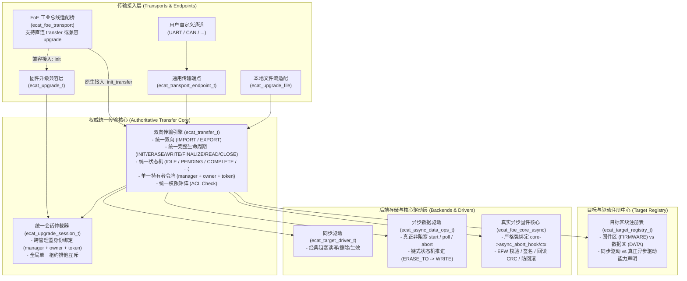
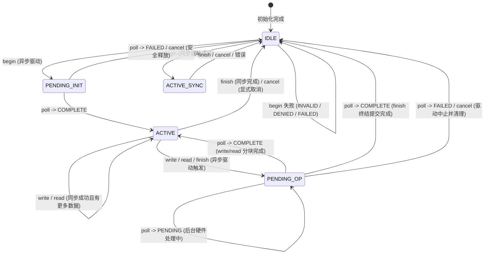

# 嵌入式统一多通道双向传输与会话核心架构设计
(Unified Multi-Transport Bidirectional Transfer & Session Architecture)

## 1. 架构目标与总体分层 (Architectural Overview & Layering)

### 1.1 核心设计理念
为终结系统中 FoE 升级、本地文件流以及用户自定义通道（UART、CAN、BLE 等）并存导致的“双重状态机、重复会话仲裁、多头取消与权限碎片化”问题，本架构确立 **“大一统传输引擎 (Unified Transfer Engine)”** 为全系统唯一的权威会话与调度核心：
1. **单一权威核心**：以 `ecat_transfer_t` 为统一核心，统管所有通道的建立、权限核验、数据流导入/导出、同步/真正异步状态机推进、以及统一取消与清理。
2. **拒绝第三套状态机**：不再引入任何旁路状态机。现有 FoE 协议栈与文件流统一通过**轻量兼容适配层 (Compatibility Adapters)** 接入；原有 `ecat_upgrade_t` 仅作为针对旧版固件升级 API 的薄向下兼容层，内部直接委托统一核心或底层共享会话。
3. **零动态分配与内存安全**：全路径零 `malloc`，所有异步暂存区、运行上下文均由调用方在初始化时一次性静态提供；严格保证栈预算在 1KB~8MB 嵌入式安全范围内。
4. **统一同步与真正非阻塞异步**：同时支持同步驱动与真正的非阻塞异步驱动，杜绝假异步（如在同步回调外部套壳 poll）。

### 1.2 架构分层全景图



---

## 2. 统一异步状态机与操作生命周期 (Unified State Machine & Lifecycle)

### 2.1 状态枚举与语义契约

系统在 `ecat_transfer_result_t` 下形成闭环的状态流转定义：

| 结果码 / 状态 | 适用场景 | 状态语义与调用方契约 |
| :--- | :--- | :--- |
| `ECAT_TRANSFER_COMPLETE` | 全部操作 | 本次操作已完全完成（分块写入成功、流结束、或异步操作已执行完毕并完成提交）。 |
| `ECAT_TRANSFER_CONTINUE` | EXPORT 读取 | 成功读取当前分块，后续仍有剩余有效数据等待读取。 |
| `ECAT_TRANSFER_PENDING`  | 异步操作 | 操作已被硬件/后台非阻塞接管并正在执行；调用方须调用 `poll` 推进，严禁并发新操作。 |
| `ECAT_TRANSFER_BUSY`     | 操作互斥 | 会话已被其他通道占用，或当前会话已有未完成的 pending 操作正在进行中。 |
| `ECAT_TRANSFER_INVALID`  | 参数错误 | 参数非法（NULL 指针、越界尺寸、错误方向等）；操作前无任何驱动副作用，允许更正后重试。 |
| `ECAT_TRANSFER_STALE`    | 令牌失效 | 调用方 `owner` 或 `token` 与当前租约不符，禁止任何操作与释放。 |
| `ECAT_TRANSFER_DENIED`   | 权限拦截 | ACL 访问控制矩阵拦截（通道 ID 或操作权限不符）。 |
| `ECAT_TRANSFER_FAILED`   | 致命错误 | 驱动或协议栈内部不可逆错误；会话安全回退并关闭，保留诊断信息。 |

### 2.2 状态转移图 (State Transitions)



### 2.3 核心生命周期保证与不变式 (Core Invariants)
1. **单会话单操作排他 (Single Pending Operation Invariant)**：
   - 任何时刻，一个激活的会话最多只能存在**一个**处于 `PENDING` 状态的底层驱动操作。
   - 在上一个操作返回 `COMPLETE` 之前，任何新的 `write`、`read`、`finish` 均直接拒绝并返回 `ECAT_TRANSFER_BUSY`。
2. **租约严格锁定 (Lease Retention Invariant)**：
   - 在 `PENDING` 期间，`manager + owner + token` 租约严格保留，任何非拥有者调用返回 `ECAT_TRANSFER_STALE`。
   - 取消操作 `cancel` 始终对合法持有者可用；一旦执行，立即触发底层异步 `abort`，解除硬件对暂存区的引用，并释放租约。
3. **单次事件通知保障 (Exactly-Once Notification)**：
   - 完成通知（`on_session_complete`）与中止通知（`on_session_abort`）有且仅有一次触发，杜绝重入与重复回调。
4. **调用串行化约束 (Strict Serialization)**：
   - 驱动接口与核心管理器要求调用方必须在主循环或受互斥保护的环境下串行调用，禁止在中断（ISR）内直接调用重入。

---

## 3. 驱动能力声明与 DATA / FIRMWARE 差异契约

### 3.1 目标驱动能力分类
在目标描述符 `ecat_target_desc_t` 中，目标驱动显式声明其支持的模式：

```c
typedef enum {
    ECAT_DRIVER_CAP_SYNC_ONLY = 0,   /* 纯同步驱动 (使用现有 io 回调) */
    ECAT_DRIVER_CAP_ASYNC            /* 真正非阻塞异步驱动 (使用 async_ops 回调) */
} ecat_driver_cap_t;
```

### 3.2 DATA 数据区块的真正异步契约
为了支持非易失性存储器（如 SPI Flash、EEPROM）的慢速擦除与长周期写入，DATA 驱动提供真正非阻塞异步 ops：

```c
typedef struct {
    /** 启动异步操作: INIT, INVALIDATE, ERASE_TO, WRITE, READ, FINALIZE, READ_OPEN, READ_CLOSE */
    ecat_async_op_result_t (*start)(void *ctx, ecat_async_data_op_t *op);
    /** 轮询当前 pending 操作进度 */
    ecat_async_op_result_t (*poll)(void *ctx, ecat_async_data_op_t *op);
    /** 中止当前操作并保证后台硬件彻底停止访问暂存内存 */
    void (*abort)(void *ctx);
} ecat_async_data_ops_t;
```

* **暂存缓冲安全**：
  - `WRITE` 操作在返回 `PENDING` 前，核心必须将数据拷贝到调用方提供的固定暂存区（Staging Buffer），暂存区大小在初始化时声明上限 `staging_capacity`。
  - 数据超限直接返回 `ECAT_TRANSFER_ERR_BOUNDARY_EXCEEDED` 拒绝，绝不发生静默截断。
  - `READ` 操作由驱动异步填充到暂存区，`poll` 返回 `COMPLETE` 后传出实际读取长度。
* **只读生命周期绝不污染**：
  - EXPORT（导出/回读）操作在任何情况下，绝不调用写驱动的 `finalize` 或会使镜像失效的 `abort`，仅调用配套的 `read_close`。
* **禁止假异步**：
  - 若目标标记为 `asynchronous`，但未配置异步 ops 或底层驱动不支持，`begin` 阶段直接拒绝（返回 `ECAT_TRANSFER_ERR_DRIVER_INIT`），绝不静默降级为同步阻塞执行。

### 3.3 FIRMWARE 固件区块的异步复用契约
* **核心复用与强制真实绑定**：
  - 固件升级涉及 EFW 容器解析、Ed25519ph 签名核验、物理回读 CRC32 比对、版本防回滚等关键安全控制。
  - `ecat_transfer_t` 在处理 FIRMWARE 类型的异步目标时，**必须直接复用既有的 `ecat_foe_core_async_t` 引擎**。
  - **防伪造 Backend 校验契约**：在 `ecat_transfer_init_async_firmware` 中强制核验 `t->core != NULL && t->core->async_abort_hook == ops->abort && t->core->async_abort_ctx == ctx`。若传入未通过真实核心初始化的伪造 ops，立即返回 -1 拒绝，确保验签、权限与安全生命周期绝不被旁路绕过。
* **防止双重租约与状态冲突**：
  - 严禁为同一个底层 Core 创建第二个独立的租约管理器。`ecat_transfer_t` 通过 `core->shared_session` 与底层状态机联动。
  - 若升级异常中止或取消，`ecat_transfer_cancel` 自动串联调用 `ecat_foe_core_async_abort`，确保目标驱动与验签上下文一次性干净释放。

---

## 4. 传输端点适配层 (Transport Endpoint Interface)

传输端点 `ecat_transport_endpoint_t` 为各类物理通道提供统一适配，新增异步轮询与状态机对齐：

1. **异步接入扩展**：
   - 新增 `ecat_transport_endpoint_poll(ep)`：在端点处于 `IMPORTING` 或 `EXPORTING` 且底层 `PENDING` 时推进操作。
   - `write_chunk` 与 `read_chunk` 正确透传 `ECAT_TRANSFER_PENDING`，不再将非 COMPLETE 误报为致命错误。
2. **事件通知与自愈边界**：
   - 端点状态扩展为：`IDLE`, `IMPORTING`, `EXPORTING`, `PENDING_OP`, `ERROR`。
   - `on_progress` 回调在每块数据写入/读取完成或 poll 完成时触发。
   - 致命错误发生时，自动执行会话清理并转移到 `ERROR` 态，发出 `on_session_abort`。

---

## 5. 内存预算与无破坏兼容设计

### 5.1 内存预算与开销控制
* **零动态内存分配 (Zero Malloc)**：所有新结构体与运行字段均在编译期或全局初始化期静态固定。
* **内存占用对比**：
  - `ecat_transfer_t`：新增异步操作上下文指针及状态枚举，内存增量 $\le 64$ 字节。
  - `ecat_transport_endpoint_t`：新增 pending 状态标志，内存增量 $\le 8$ 字节。
  - 栈深度：所有调用链深度严格控制在 3 层函数以内，最大局部变量 $\le 128$ 字节，完全兼容 1KB 极端小栈环境。

### 5.2 兼容层与分阶段平滑迁移边界 (Compatibility & Boundaries)
为确保现有测试与调用方 100% 不破坏：
1. **统一会话仲裁核心 (Authoritative Session Core)**：
   - `ecat_upgrade_session_t` 为全系统唯一的会话租约仲裁器，跨管理器（`ecat_transfer_t` 与 `ecat_upgrade_t`）、跨传输通道（FoE、文件、自定义通道）实现严格的互斥与所有权绑定。
   - 杜绝双重租约与跨管理器非法取消：非持有者无法释放或操作其他管理器的激活租约。
2. **FoE 工业总线适配桥 (`ecat_foe_transport.c`) 双模式接入与迁移成果**：
   - **权威统一核心接入 (`ecat_foe_transport_init_transfer`)**：
     FoE 传输适配器现已完全原生接入权威统一双向传输核心 `ecat_transfer_t`。在该模式下，FoE 通道直接受管于统一状态机、统一目标注册表 ACL 访问矩阵与完整驱动生命周期，消除了 FoE 与其它通道割裂维护的双重状态机；
   - **遗留兼容模式 (`ecat_foe_transport_init`)**：
     保留通过 `ecat_upgrade_t` 接入的兼容路径，底层通过全局唯一的 `ecat_upgrade_session_t` 与主管理器强绑定且互斥排他；
   - **保证现存协议栈 100% 行为零回归**：
     现有 Beckhoff SSC / SOES 协议栈无需任何上层改动即可无缝运行，全部测试套件与 Bootloader 验证均零破坏保持向后兼容。
3. **原子完整写入与错误安全处理契约 (All-or-Nothing Full Write Semantics)**：
   - `ecat_transfer_write` 与端点写接口要求分块原子完整落盘；
   - 驱动实际写入长度 `actual_length < length`（包括零写入或部分短写）一律被严格裁定为 `ECAT_TRANSFER_ERR_DRIVER_WRITE`，立即中止并安全回退释放租约，绝不发生数据静默截断或丢失；
   - 异步擦除 `ERASE_TO` 作为显式非阻塞驱动阶段执行，擦除完成后由内部状态机自动无缝开启第二阶段 `WRITE`，对外保持透明推进。
4. **真实固件核心安全复用与单次精确中止契约**：
   - 固件异步传输通过 `ecat_transfer_init_async_firmware` 强制绑定权威固件核心（`core->async_abort_hook == ops->abort && core->async_abort_ctx == ctx`），拦截伪造 ops 绕过验签；
   - 写入固件时强制深拷贝至独立暂存区，确保调用方输入缓冲区被修改或释放时数据完整性与 CRC32 绝对稳定；
   - 中止时严格遵循单次精确清理：针对异步目标仅调用 `async_ops->abort`，针对固件异步目标同时复位底层核心与驱动，杜绝重复同步中止与状态机悬挂。
5. **真实硬件边界声明**：
   - 本项目交付物包含通用接口、统一核心、端点适配器、Mock 验证与真实 SOES/Monocypher 宿主集成测试。
   - **明确边界**：本项目未虚构真实 UART/CAN 硬件寄存器驱动，尚未在真实物理 32 位 MCU 硬件上进行动态在线升级联调，真实硬件部署时需挂载对应芯片的外设驱动。

---

## 6. 可执行分步实施计划 (Executable Phased Plan)


* **Step 1 (已就绪)**：提交总体设计文档 `docs/architecture/unified-transfer-architecture.md` 并更新进展日志。
* **Step 2**：在 `include/ecat_target_registry.h` 中引入真正的异步驱动契约 `ecat_async_data_ops_t` 与能力位；编写失败测试验证同步与异步驱动辨识及 ABI 安全；实施并提交。
* **Step 3**：在 `src/ecat_transfer.c` 中实现统一异步状态机与 `ecat_transfer_poll`；支持 DATA 异步分阶段推进及 FIRMWARE 异步复用；编写失败测试（Cover pending、poll、cancel、防双重操作、ACL）并提交。
* **Step 4**：在 `src/ecat_transport_endpoint.c` 中支持 `poll` 与 `PENDING` 穿透，实现单次通知保障；编写失败测试并提交。
* **Step 5**：优化 `src/ecat_upgrade.c`，收敛到统一会话体系；确保现有所有测试与 FoE 适配器完全通过。
* **Step 6**：在干净归档下执行全部 6 项核心测试，并进行 32 位编译检查，更新真实边界说明，提交复审。
