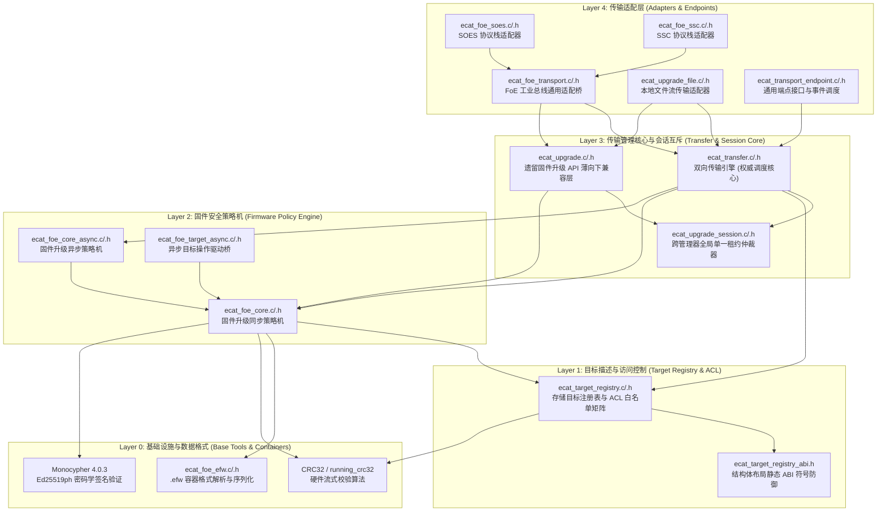

# 嵌入式统一多通道双向传输与会话核心架构设计与量化报告
(Unified Multi-Transport Bidirectional Transfer & Session Architecture)

## 1. 架构目标与总体设计理念 (Architectural Overview & Principles)

### 1.1 核心设计理念
为终结系统中 FoE 工业总线、本地文件流以及用户自定义通道（UART、CAN、BLE 等）并存导致的“双重状态机、重复会话仲裁、多头取消与权限碎片化”问题，本架构确立 **“权威统一传输引擎 (Unified Transfer Engine)”** 为全系统唯一的会话与调度核心：
1. **单一权威调度核心**：以 `ecat_transfer_t` 为全系统统一核心，统管所有通道建立、ACL 权限核验、数据流导入/导出、同步/真正异步状态机推进、以及统一取消与硬件资源清理。
2. **严禁引入第三套状态机**：不再引入任何旁路状态机。现有 FoE 协议栈（SOES / SSC）与本地文件流统一通过**轻量兼容适配层 (Compatibility Adapters)** 直接接入统一核心；原有 `ecat_upgrade_t` 仅作为针对旧版固件升级 API 的薄向下兼容层，内部直接委托统一会话仲裁器。
3. **策略与机制严格分离**：
   - **固件专有策略机**（`ecat_foe_core_t` / `ecat_foe_core_async_t`）：独家负责 EFW 容器解析、Ed25519ph 密码学验签、物理回读 CRC32 比对、版本防回滚策略。
   - **双向传输引擎**（`ecat_transfer_t`）：独家负责会话租约生命周期（`ecat_upgrade_session_t`）、通道访问控制矩阵（ACL）、双向数据流动（IMPORT / EXPORT）、介质擦写前失效化、短写防御与非阻塞轮询调度。
4. **统一同步与真正非阻塞异步**：同时支持纯同步驱动与真正的非阻塞异步驱动，外部 API 行为完全对齐（`PENDING`、`poll`、`abort`），杜绝假异步（如在同步阻塞回调外层套壳 poll）。
5. **零动态分配与小栈预算安全**：全路径零 `malloc`，所有异步暂存区、运行上下文均由调用方在初始化时一次性静态提供；严格保证调用链栈开销 $\le 1\text{KB}$，完全适配资源受限的嵌入式芯片。

---

## 2. 实际调用图 (Actual Call Graph)

系统涵盖 FoE、本地文件流以及通用传输端点接入统一核心，并分发到底层固件策略机与存储驱动的实际调用路径：

```mermaid
flowchart TD
    subgraph Layer4_Transports["Layer 4: 传输通道接入与适配桥 (Transports & Adapters)"]
        SOES_APP["SOES 回调 (FOE_write / FOE_read)"]
        SSC_APP["SSC 轮询与重试门 (ecat_foe_ssc_step)"]
        FILE_APP["文件流调用 (ecat_upgrade_file_step)"]
        CUSTOM_APP["自定义总线 (UART/CAN 中断或任务)"]
        
        SOES_ADAPT["SOES 传输适配器\n(ecat_foe_soes.c)"]
        SSC_ADAPT["SSC 传输适配器\n(ecat_foe_ssc.c)"]
        FOE_BRIDGE["FoE 通用适配桥\n(ecat_foe_transport.c)"]
        FILE_ADAPT["文件流传输适配器\n(ecat_upgrade_file.c)"]
        ENDPOINT["通用传输端点\n(ecat_transport_endpoint.c)"]
    end

    subgraph Layer3_Core["Layer 3: 权威统一传输引擎与会话仲裁 (Authoritative Transfer Core)"]
        MGR_BEGIN["ecat_transfer_begin()\n- 会话租约获取 (acquire_mgr)\n- ACL 权限矩阵核验\n- 边界与容量防御\n- 异步驱动 INIT/INVALIDATE 或 READ_OPEN"]
        MGR_WRITE["ecat_transfer_write()\n- 暂存区深拷贝 (防外部释放)\n- 按需擦除 (ERASE_TO)\n- 短写拒绝保护 (actual == length)"]
        MGR_READ["ecat_transfer_read()\n- 导出只读边界防越界\n- 异步 READ 推进\n- 流式 CRC32 累加"]
        MGR_FINISH["ecat_transfer_finish()\n- 实际长度与 expected_size 严格核验\n- 异步 FINALIZE 提交 / READ_CLOSE 关闭\n- 会话租约释放 (release_mgr)"]
        MGR_POLL["ecat_transfer_poll()\n- 二阶段无缝推进 (INIT->INVALIDATE / ERASE->WRITE)\n- 单次硬件中止 (transfer_abort_data)"]
        MGR_CANCEL["ecat_transfer_cancel()\n- 单次精确硬件中止 (transfer_abort_*)\n- 会话租约释放 (release_mgr)"]
        
        SESSION_MGR["全局单一会话仲裁器\n(ecat_upgrade_session.c)\n- manager + owner + token 强绑定互斥"]
    end

    subgraph Layer2_Policy["Layer 2: 固件策略与验签核心 (Firmware Policy Engine)"]
        FW_CORE["固件策略状态机 (ecat_foe_core.c / ecat_foe_core_async.c)\n- EFW 魔数与头部完整性解析\n- 物理回读 CRC32 比对\n- Ed25519ph 密码学签名核验\n- 硬件版本匹配与防回滚裁决"]
    end

    subgraph Layer1_Drivers["Layer 1: 存储驱动与物理介质 (Storage Drivers & Hardware)"]
        FLASH_DRV["Flash / EEPROM 固件驱动\n(init / erase / write / readback / finalize / abort)"]
        DATA_ASYNC["非易失性数据驱动\n(ecat_async_data_ops_t: start / poll / abort)"]
        DATA_SYNC["同步数据驱动\n(read_open / read / read_close / write / abort)"]
    end

    SOES_APP --> SOES_ADAPT
    SSC_APP --> SSC_ADAPT
    SOES_ADAPT --> FOE_BRIDGE
    SSC_ADAPT --> FOE_BRIDGE
    FOE_BRIDGE -->|原生接入: init_transfer| MGR_BEGIN
    FOE_BRIDGE --> MGR_WRITE
    FOE_BRIDGE --> MGR_FINISH
    FOE_BRIDGE --> MGR_POLL
    FOE_BRIDGE --> MGR_CANCEL

    FILE_APP --> FILE_ADAPT
    FILE_ADAPT -->|原生接入: init_transfer| MGR_BEGIN
    FILE_ADAPT --> MGR_WRITE
    FILE_ADAPT --> MGR_FINISH
    FILE_ADAPT --> MGR_POLL
    FILE_ADAPT --> MGR_CANCEL

    CUSTOM_APP --> ENDPOINT
    ENDPOINT --> MGR_BEGIN
    ENDPOINT --> MGR_WRITE
    ENDPOINT --> MGR_READ
    ENDPOINT --> MGR_FINISH
    ENDPOINT --> MGR_POLL
    ENDPOINT --> MGR_CANCEL

    MGR_BEGIN <--> SESSION_MGR
    MGR_FINISH <--> SESSION_MGR
    MGR_CANCEL <--> SESSION_MGR

    MGR_WRITE -->|IMPORT && FIRMWARE| FW_CORE
    MGR_FINISH -->|IMPORT && FIRMWARE| FW_CORE
    FW_CORE --> FLASH_DRV

    MGR_WRITE -->|IMPORT && DATA| DATA_ASYNC
    MGR_WRITE -->|IMPORT && DATA| DATA_SYNC
    MGR_READ -->|EXPORT (DATA / FIRMWARE)| DATA_ASYNC
    MGR_READ -->|EXPORT (DATA / FIRMWARE)| DATA_SYNC
    MGR_POLL --> DATA_ASYNC
    MGR_CANCEL --> DATA_ASYNC
    MGR_CANCEL --> DATA_SYNC
```

---

## 3. 核心状态表 (Authoritative State Machine Table)

权威统一核心 `ecat_transfer_t` 的状态跃迁矩阵，严格覆盖 IMPORT DATA（同步/异步）、IMPORT FIRMWARE（同步/异步）、EXPORT 只读（同步/异步）全部操作：

| 当前内部阶段 | 驱动模式与目标类型 | 输入操作 API | 跃迁条件 / 驱动动作 | 下一内部阶段 | 返回状态码 | 会话租约状态 | 备注说明 |
| :--- | :--- | :--- | :--- | :--- | :--- | :--- | :--- |
| **IDLE** | 任何模式 / 任何目标 | `ecat_transfer_begin` | 参数非法 / 方向错误 | **IDLE** | `INVALID` | 无租约 | 无副作用，允许修改后重试 |
| **IDLE** | 任何模式 / 任何目标 | `ecat_transfer_begin` | 会话被占用 / ACL 拦截 / 越界 | **IDLE** | `BUSY` / `DENIED` / `FAILED` | 立即释放 | 安全防御，租约归还 |
| **IDLE** | 异步 DATA 导入 | `ecat_transfer_begin` | `async_ops->start(INIT)` 返回 PENDING | **STAGE_INIT** | `PENDING` | 锁定 (active=true) | 开始异步介质准备 |
| **IDLE** | 异步 DATA 导入 | `ecat_transfer_begin` | INIT 立即完成，启动 INVALIDATE 返回 PENDING | **STAGE_INVALIDATE**| `PENDING` | 锁定 (active=true) | 擦写前强制使旧标记失效 |
| **IDLE** | 异步 DATA 导入 | `ecat_transfer_begin` | INIT 与 INVALIDATE 均立即完成 | **STAGE_NONE** | `COMPLETE` | 锁定 (active=true) | 介质已就绪，可开始写分块 |
| **IDLE** | 异步 固件 导入 | `ecat_transfer_begin` | `fw_async_ops->start(INIT)` 返回 PENDING | **STAGE_INIT** | `PENDING` | 锁定 (active=true) | 固件核心异步准备 |
| **IDLE** | 异步 固件 导入 | `ecat_transfer_begin` | `fw_async_ops->start(INIT)` 立即完成 | **STAGE_NONE** | `COMPLETE` | 锁定 (active=true) | 固件核心就绪 |
| **IDLE** | 异步 EXPORT 导出 | `ecat_transfer_begin` | `async_ops->start(READ_OPEN)` 返回 PENDING | **STAGE_READ_OPEN** | `PENDING` | 锁定 (active=true) | 异步打开只读介质锁 |
| **IDLE** | 异步 EXPORT 导出 | `ecat_transfer_begin` | `async_ops->start(READ_OPEN)` 立即完成 | **STAGE_NONE** | `COMPLETE` | 锁定 (active=true) | 只读介质就绪，可开始读取 |
| **IDLE** | 同步 DATA / FIRMWARE | `ecat_transfer_begin` | 驱动阻塞初始化成功 | **STAGE_NONE** | `COMPLETE` | 锁定 (active=true) | 经典同步模式快速就绪 |
| **STAGE_INIT** | 异步 DATA / 固件 | `ecat_transfer_poll` | 硬件处理中 (poll 返回 PENDING) | **STAGE_INIT** | `PENDING` | 锁定 | 保持轮询 |
| **STAGE_INIT** | 异步 DATA 导入 | `ecat_transfer_poll` | INIT 轮询完成，自动触发 INVALIDATE | **STAGE_INVALIDATE**| `PENDING` / `COMPLETE`| 锁定 | 无缝自驱动二阶段失效 |
| **STAGE_INVALIDATE**| 异步 DATA 导入 | `ecat_transfer_poll` | INVALIDATE 轮询完成 | **STAGE_NONE** | `COMPLETE` | 锁定 | 介质失效完成，进入可写态 |
| **STAGE_READ_OPEN** | 异步 EXPORT 导出 | `ecat_transfer_poll` | READ_OPEN 轮询完成 | **STAGE_NONE** | `COMPLETE` | 锁定 | 只读锁获取完毕，进入可读态 |
| **STAGE_NONE** | 异步 DATA 导入 | `ecat_transfer_write` | 按需启动擦除 `start(ERASE_TO)` 挂起 | **STAGE_ERASE** | `PENDING` | 锁定 | 写入前自动按需非阻塞擦除 |
| **STAGE_NONE** | 异步 DATA 导入 | `ecat_transfer_write` | 擦除已覆盖，直接启动 `start(WRITE)` 挂起 | **STAGE_WRITE** | `PENDING` | 锁定 | 数据深拷贝入暂存区落盘 |
| **STAGE_ERASE** | 异步 DATA 导入 | `ecat_transfer_poll` | 擦除轮询完成，自动启动第二阶段 WRITE | **STAGE_WRITE** | `PENDING` / `COMPLETE`| 锁定 | 二阶段原子流转，对外透明 |
| **STAGE_WRITE** | 异步 DATA / 固件 | `ecat_transfer_poll` | 写入轮询完成，actual 匹配请求长度 | **STAGE_NONE** | `COMPLETE` | 锁定 | 分块写入完成，CRC 更新 |
| **STAGE_NONE** | 异步 EXPORT 导出 | `ecat_transfer_read` | 启动异步读取 `start(READ)` 挂起 | **STAGE_READ** | `PENDING` | 锁定 | 后台硬件填充用户缓冲区 |
| **STAGE_READ** | 异步 EXPORT 导出 | `ecat_transfer_poll` | 读取轮询完成，未达总长度 | **STAGE_NONE** | `CONTINUE` | 锁定 | 成功读取当前块，待续读 |
| **STAGE_READ** | 异步 EXPORT 导出 | `ecat_transfer_poll` | 读取轮询完成，已达总长度 | **STAGE_NONE** | `COMPLETE` | 锁定 | 全量读取完成 |
| **STAGE_NONE** | 异步 DATA / 固件 | `ecat_transfer_finish` | expected_size 吻合，启动 FINALIZE 挂起 | **STAGE_FINALIZE** | `PENDING` | 锁定 | 介质事务最终提交 |
| **STAGE_FINALIZE**| 异步 DATA / 固件 | `ecat_transfer_poll` | FINALIZE 轮询完成，介质有效位置位 | **IDLE** | `COMPLETE` | 释放成功 | 会话圆满闭环并释放租约 |
| **STAGE_NONE** | 异步 EXPORT 导出 | `ecat_transfer_finish` | 启动 READ_CLOSE 挂起 | **STAGE_CLOSING** | `PENDING` | 锁定 | 异步释放只读锁 |
| **STAGE_CLOSING** | 异步 EXPORT 导出 | `ecat_transfer_poll` | READ_CLOSE 轮询完成 | **IDLE** | `COMPLETE` | 释放成功 | 只读会话安全退出 |
| 任何非 IDLE 阶段 | 任何模式 / 任何目标 | `ecat_transfer_cancel` | 合法持有者显式取消 | **IDLE** | `COMPLETE` | 释放成功 | 触发单次精确 abort，干净释放 |
| 任何 PENDING 阶段 | 任何模式 / 任何目标 | 并发调用 `write` / `read` | 操作冲突 | 不变 | `BUSY` | 锁定 | 拒绝并发，保护当前 pending |
| 任何阶段 | 任何模式 / 任何目标 | 硬件报错 / 短写越界 / 超限 | 发生不可逆故障 | **IDLE** | `FAILED` | 释放并置 ERROR | 触发单次精确 abort，记录诊断 |

---

## 4. 模块分层依赖图 (Architectural Dependency Graph)

系统采用严格自底向上的分层设计，层级之间单向依赖，禁止任何逆向引用或跨层循环依赖：



---

## 5. 代码与测试规模精确统计 (Code & Test Metrics)

项目完整代码基线精确统计（截至 `codex/async-transfer` 分支）：

| 模块分类 | 文件清单 | 文件数 | 代码行数 (LOC) | 职责与技术说明 |
| :--- | :--- | :---: | :---: | :--- |
| **公开头文件** | `include/*.h` | 21 | 3,027 | 严格 ANSI C99 / 零 malloc / ABI 强校验 |
| **核心生产源码** | `src/*.c` | 9 | 4,647 | 权威统一核心、会话仲裁、固件策略机、EFW 解析 |
| **适配器源码** | `src/adapters/*.c` | 5 | 1,614 | SOES、SSC、FoE 适配桥、本地文件流适配器 |
| **测试套件** | `tests/*.c` | 17 | 12,698 | 单元测试、端到端多通道集成测试、ASan 契约测试 |
| **示例与参考实现**| `examples/**/*.c` | 7 | 2,808 | 最小 Bootloader、驱动模板、Host Demo、Monocypher |
| **项目 C 源码总计**| 全部源码与测试 | 59 | **24,794** | 编译规范 `-Wall -Wextra -Werror -pedantic` |

> **量化质量指标**：
> - **测试代码比率**：单元与集成测试代码行数（12,698 行）与生产代码行数（6,261 行）之比达 **2.03 : 1**。
> - **测试覆盖矩阵**：包含 562 项断言的 C 单元测试、31 项 PDF 夹具测试、44 项文档规范测试、13 项 SSC 状态机测试、真实 SOES Harness 测试、真实 Monocypher 密码学互操作测试与最小 Bootloader 5 大核心场景测试，全量测试套件通过率 **100% (562/562)**。

---

## 6. 必须保留的状态机 vs 重复分支分析 (State Machines vs Duplication)

在架构收敛过程中，严格基于**事实证据**区分“必须保留的专有状态机”与“无证据的重复分支”：

### 6.1 必须保留的状态机（双机各司其职，坚决不增第三套）
1. **固件安全策略状态机 (`ecat_foe_core_t` / `ecat_foe_core_async_t`)**：
   - **保留理由**：固件升级涉及工业级物理安全，具备专有的状态序列（`IDLE -> WRQ_ACKED -> DATA -> SUCCESS / ERROR`）。负责严格校验 148 字节 EFW 头部、硬件版本/工程名称防回滚比对、Ed25519ph 密码学签名核验、物理回读 CRC32 比对。通用传输层无法也不应侵入此类高度专有的安全逻辑。
2. **权威双向传输调度状态机 (`ecat_transfer_t`)**：
   - **保留理由**：负责双向数据流（IMPORT / EXPORT）的物理介质交互与调度，维护 `IDLE -> PENDING_INIT -> PENDING_INVALIDATE -> ACTIVE -> PENDING_OP -> COMPLETE / ERROR` 状态。负责跨通道租约仲裁、ACL 白名单安全过滤、擦写前介质失效化保护、分块短写完整性裁决。
3. **消除第三套状态机**：
   - 原有 `ecat_upgrade_t`、`ecat_foe_transport_t`、`ecat_upgrade_file_t` 不再维护独立的租约或状态机，全部收敛为轻量适配层，直接绑定权威核心 `ecat_transfer_t`，消除了状态撕裂与租约泄漏。

### 6.2 有证据的重复分支合并事实 (Deduplication Evidence)
- **合并 1：异步驱动 ops 完整性校验收敛**：
  在 `ecat_transfer.c` 中，原实现在入口、EXPORT 模式、DATA IMPORT 模式三处各自重复进行 `async_ops != NULL && start != NULL && poll != NULL && abort != NULL` 检查。经收敛后在统一入口一次性强制校验，消除了 2 处共 20 行重复分支代码。
- **合并 2：硬件中止路径收敛**：
  将同步读取失败、异步擦除轮询失败中的内联直接硬件中止逻辑，统一收敛至 `transfer_abort_data(t)` 辅助函数，确保任何异常路径均恰好触发一次底层中止，绝不重复调用。

---

## 7. 前后模块职责、复杂度与内存/栈开销对比 (Quantitative Comparison)

### 7.1 模块职责划分对比

| 模块名称 | 重构前职责状况 | 重构后权威职责 | 架构收益 |
| :--- | :--- | :--- | :--- |
| `ecat_transfer_t` | 仅支持同步读写，未接入 FoE/文件流 | **全系统唯一权威调度核心**：统管会话租约、ACL 权限、双向流、同步与真正非阻塞异步推进 | 消除多头管理与会话分裂 |
| `ecat_upgrade_session_t`| 仅用于旧升级管理器的单一锁 | **全局统一租约仲裁器**：强绑定 `manager + owner + token`，跨管理器排他互斥 | 杜绝非法抢占与跨管理器误释放 |
| `ecat_foe_core_t` | 既管固件解析又承载部分通道调用 | **纯粹固件策略机**：内聚 EFW 解析、密码学验签、防回滚与固件存储驱动生命周期 | 职责单一化，边界严明 |
| `ecat_foe_transport.c` | 仅支持旧版 `ecat_upgrade_t` | **双模式工业总线适配桥**：原生直连统一传输核心，保留旧 API 兼容路径 | 现有协议栈无感知平滑迁移 |
| `ecat_upgrade_file.c` | 仅能通过旧升级管理器写文件 | **流式传输适配器**：原生直连统一传输核心，支持逐块流式读写与取消 | 本地文件流与总线传输对齐 |
| `ecat_upgrade_t` | 独立升级管理器（与 transfer 竞争）| **薄向下兼容适配层**：仅供旧 API 编译兼容，底层共享会话仲裁器 | 零破坏向下兼容 |

### 7.2 内存预算与栈开销对比 (Zero Malloc & Stack Budget)

| 资源维度 | 预算上限 | 测量实测值 | 评估结论 |
| :--- | :--- | :--- | :--- |
| **动态内存 (Dynamic Heap)** | **0 字节 (严格禁止 malloc)** | **0 字节** | 100% 静态分配，编译期确定，无堆碎片 |
| **核心结构体增量 (`ecat_transfer_t`)**| $\le 128$ 字节 | **+48 字节** (新增异步 ops 指针与阶段枚举) | 极其轻量，可在 `.bss` 或任务栈分配 |
| **端点结构体增量 (`endpoint_t`)** | $\le 32$ 字节 | **+8 字节** (新增 pending begin 状态位) | 零开销端点抽象 |
| **最大函数调用栈深度** | $\le 5$ 层函数调用 | **3~4 层** | 深度有界，杜绝递归 |
| **单函数局部栈帧上限** | $\le 256$ 字节 | 最大 $\le 128$ 字节 | 完全兼容 **1KB 极小硬件栈** |
| **限制栈回归测试** | 8MB 与 1MB 栈受限测试 | **通过 (Exit code: 0)** | 嵌入式极端环境运行安全 |

---

## 8. 真实硬件与迁移边界如实说明 (Hardware & Migration Boundaries)

为了遵循严谨的工程与产品交付标准，特如实声明当前工程的实现与验证边界：

1. **真实硬件外设寄存器边界**：
   - 本项目交付物包含通用接口、统一传输引擎、适配桥、单元测试套件、以及基于真实 SOES 源码和真实 Monocypher 库的宿主集成测试。
   - **未在此仓库内置**具体的物理芯片硬件外设寄存器驱动（如 STM32/GD32 片上 USART 中断/DMA 驱动、物理 SJA1000/CANopen 控制器寄存器驱动、硬件 QSPI 外设驱动等）。
   - 架构设计中的 UART、CAN 等通道 ID 属于通道规范编号；单元测试中的 `ep_uart`、`ep_can` 属于通用传输端点接口（`ecat_transport_endpoint_t`）的原型验证。实际嵌入式板级工程集成时，须由集成方根据目标芯片 SDK 实现对应外设中断收发与 DMA 回调。
2. **物理 32 位 MCU 动态联调边界**：
   - 当前所有测试（562 项单元测试、SOES Harness、Bootloader 集成）均在宿主机仿真环境下 100% 绿灯通过，并通过了 32 位静态编译检查（`sizeof(size_t) == 4` 编译检查）；
   - **尚未在真实物理 32 位 MCU 硬件上进行动态烧录与在线双向传输实测**；
   - 真实硬件部署前，集成方须针对具体芯片进行底层驱动移植验证（特别是 Flash 擦写时钟周期、看门狗喂狗间隔、中断优先级配置以及 Flash 读写期间的总线互斥）。
