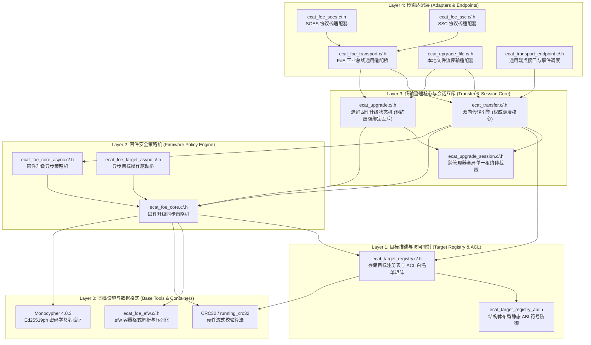

# 嵌入式统一多通道双向传输与会话核心架构设计与量化报告
(Unified Multi-Transport Bidirectional Transfer & Session Architecture)

## 1. 架构目标与总体设计理念 (Architectural Overview & Principles)

### 1.1 核心设计理念
为终结系统中 FoE 工业总线、本地文件流以及用户自定义通道（UART、CAN、BLE 等）并存导致的“双重状态机、重复会话仲裁、多头取消与权限碎片化”问题，本架构确立 **“权威统一传输引擎 (Unified Transfer Engine)”** 为全系统唯一的会话与调度核心：
1. **单一权威调度核心**：以 `ecat_transfer_t` 为全系统统一核心，统管所有通道建立、ACL 权限核验、数据流导入/导出、同步/真正异步状态机推进、以及统一取消与硬件资源清理。
2. **严禁引入第三套状态机**：不再引入任何旁路状态机。现有 FoE 协议栈（SOES / SSC）与本地文件流统一通过**轻量兼容适配层 (Compatibility Adapters)** 原生直连统一传输核心 (`ecat_transfer_t`)；原有 `ecat_upgrade_t` 保留其固件业务调度状态机以确保现有代码 100% 行为兼容，与权威统一传输核心在全局会话仲裁层 (`ecat_upgrade_session_t`) 与底层 core 状态层实现强绑定互斥与 ACL 协同（详见 6.2 节迁移边界）。
3. **策略与机制严格分离**：
   - **固件专有策略机**（`ecat_foe_core_t` / `ecat_foe_core_async_t`）：独家负责 EFW 容器解析、Ed25519ph 密码学验签、物理回读 CRC32 比对、版本防回滚策略。
   - **双向传输引擎**（`ecat_transfer_t`）：独家负责会话租约生命周期（`ecat_upgrade_session_t`）、通道访问控制矩阵（ACL）、双向数据流动（IMPORT / EXPORT）、介质擦写前失效化、短写防御与非阻塞轮询调度。
4. **统一同步与真正非阻塞异步**：同时支持纯同步驱动与真正的非阻塞异步驱动，外部 API 行为完全对齐（`PENDING`、`poll`、`abort`），杜绝假异步（如在同步阻塞回调外层套壳 poll）。
5. **零动态分配与内存边界清晰**：全路径零 `malloc`，所有异步暂存区、运行上下文均由调用方在初始化时一次性静态提供；严格区分静态结构体上下文、调用方数据缓冲区与运行时调用栈，杜绝递归与隐式大局部变量。

---

## 2. 实际调用图 (Actual Call Graph)

系统涵盖 FoE、本地文件流以及通用传输端点接入统一核心，并分发到底层固件策略机与存储驱动的实际调用路径：

```mermaid
flowchart TD
    subgraph Layer4_Transports["Layer 4: 传输通道接入与适配桥 (Transports & Adapters)"]
        SOES_APP["SOES 回调 (FOE_write / FOE_read)"]
        SSC_APP["SSC 轮询与重试门 (ecat_foe_ssc_step)"]
        FILE_APP["文件流调用 (ecat_upgrade_file_step)"]
        CUSTOM_APP["自定义总线 (UART/CAN 中断或任务)"]
        
        SOES_ADAPT["SOES 传输适配器\n(ecat_foe_soes.c)"]
        SSC_ADAPT["SSC 传输适配器\n(ecat_foe_ssc.c)"]
        FOE_BRIDGE["FoE 通用适配桥\n(ecat_foe_transport.c)"]
        FILE_ADAPT["文件流传输适配器\n(ecat_upgrade_file.c)"]
        ENDPOINT["通用传输端点\n(ecat_transport_endpoint.c)"]
    end

    subgraph Layer3_Core["Layer 3: 权威统一传输引擎与会话仲裁 (Authoritative Transfer Core)"]
        MGR_BEGIN["ecat_transfer_begin()\n- 会话租约获取 (acquire_mgr)\n- ACL 权限矩阵核验\n- 边界与容量防御\n- 异步驱动 INIT/INVALIDATE 或 READ_OPEN"]
        MGR_WRITE["ecat_transfer_write()\n- 暂存区深拷贝 (防外部释放)\n- 按需擦除 (ERASE_TO)\n- 短写拒绝保护 (actual == length)"]
        MGR_READ["ecat_transfer_read()\n- 导出只读边界防越界\n- 异步 READ 推进\n- 流式 CRC32 累加"]
        MGR_FINISH["ecat_transfer_finish()\n- 实际长度与 expected_size 严格核验\n- 异步 FINALIZE 提交 / READ_CLOSE 关闭\n- 会话租约释放 (release_mgr)"]
        MGR_POLL["ecat_transfer_poll()\n- 二阶段无缝推进 (INIT->INVALIDATE / ERASE->WRITE)\n- 单次硬件中止 (transfer_abort_data)"]
        MGR_CANCEL["ecat_transfer_cancel()\n- 单次精确硬件中止 (transfer_abort_*)\n- 会话租约释放 (release_mgr)"]
        
        SESSION_MGR["全局单一会话仲裁器\n(ecat_upgrade_session.c)\n- manager + owner + token 强绑定互斥"]
    end

    subgraph Layer2_Policy["Layer 2: 固件策略与验签核心 (Firmware Policy Engine)"]
        FW_CORE["固件策略状态机 (ecat_foe_core.c / ecat_foe_core_async.c)\n- EFW 魔数与头部完整性解析\n- 物理回读 CRC32 比对\n- Ed25519ph 密码学签名核验\n- 硬件版本匹配与防回滚裁决"]
    end

    subgraph Layer1_Drivers["Layer 1: 存储驱动与物理介质 (Storage Drivers & Hardware)"]
        FLASH_DRV["Flash / EEPROM 固件驱动\n(init / erase / write / readback / finalize / abort)"]
        DATA_ASYNC["非易失性数据驱动\n(ecat_async_data_ops_t: start / poll / abort)"]
        DATA_SYNC["同步数据驱动\n(read_open / read / read_close / write / abort)"]
    end

    SOES_APP --> SOES_ADAPT
    SSC_APP --> SSC_ADAPT
    SOES_ADAPT --> FOE_BRIDGE
    SSC_ADAPT --> FOE_BRIDGE
    FOE_BRIDGE -->|原生接入: init_transfer| MGR_BEGIN
    FOE_BRIDGE --> MGR_WRITE
    FOE_BRIDGE --> MGR_FINISH
    FOE_BRIDGE --> MGR_POLL
    FOE_BRIDGE --> MGR_CANCEL

    FILE_APP --> FILE_ADAPT
    FILE_ADAPT -->|原生接入: init_transfer| MGR_BEGIN
    FILE_ADAPT --> MGR_WRITE
    FILE_ADAPT --> MGR_FINISH
    FILE_ADAPT --> MGR_POLL
    FILE_ADAPT --> MGR_CANCEL

    CUSTOM_APP --> ENDPOINT
    ENDPOINT --> MGR_BEGIN
    ENDPOINT --> MGR_WRITE
    ENDPOINT --> MGR_READ
    ENDPOINT --> MGR_FINISH
    ENDPOINT --> MGR_POLL
    ENDPOINT --> MGR_CANCEL

    MGR_BEGIN <--> SESSION_MGR
    MGR_FINISH <--> SESSION_MGR
    MGR_CANCEL <--> SESSION_MGR

    MGR_WRITE -->|IMPORT && FIRMWARE| FW_CORE
    MGR_FINISH -->|IMPORT && FIRMWARE| FW_CORE
    FW_CORE --> FLASH_DRV

    MGR_WRITE -->|IMPORT && DATA| DATA_ASYNC
    MGR_WRITE -->|IMPORT && DATA| DATA_SYNC
    MGR_READ -->|EXPORT (DATA / FIRMWARE)| DATA_ASYNC
    MGR_READ -->|EXPORT (DATA / FIRMWARE)| DATA_SYNC
    MGR_POLL --> DATA_ASYNC
    MGR_CANCEL --> DATA_ASYNC
    MGR_CANCEL --> DATA_SYNC
```

---

## 3. 核心状态表 (Authoritative State Machine Table)

权威统一核心 `ecat_transfer_t` 的状态跃迁矩阵，严格覆盖 IMPORT DATA（同步/异步）、IMPORT FIRMWARE（同步/异步）、EXPORT 只读（同步/异步）全部操作：

| 当前内部阶段 | 驱动模式与目标类型 | 输入操作 API | 跃迁条件 / 驱动动作 | 下一内部阶段 | 返回状态码 | 会话租约状态 | 备注说明 |
| :--- | :--- | :--- | :--- | :--- | :--- | :--- | :--- |
| **IDLE** | 任何模式 / 任何目标 | `ecat_transfer_begin` | 参数非法 / 方向错误 | **IDLE** | `INVALID` | 无租约 | 无副作用，允许修改后重试 |
| **IDLE** | 任何模式 / 任何目标 | `ecat_transfer_begin` | 会话被占用 / ACL 拦截 / 越界 | **IDLE** | `BUSY` / `DENIED` / `FAILED` | 立即释放 | 安全防御，租约归还 |
| **IDLE** | 异步 DATA 导入 | `ecat_transfer_begin` | `async_ops->start(INIT)` 返回 PENDING | **STAGE_INIT** | `PENDING` | 锁定 (active=true) | 开始异步介质准备 |
| **IDLE** | 异步 DATA 导入 | `ecat_transfer_begin` | INIT 立即完成，启动 INVALIDATE 返回 PENDING | **STAGE_INVALIDATE**| `PENDING` | 锁定 (active=true) | 擦写前强制使旧标记失效 |
| **IDLE** | 异步 DATA 导入 | `ecat_transfer_begin` | INIT 与 INVALIDATE 均立即完成 | **STAGE_NONE** | `COMPLETE` | 锁定 (active=true) | 介质已就绪，可开始写分块 |
| **IDLE** | 固件导入 (同步/异步后端)| `ecat_transfer_begin` | `ecat_foe_core_begin_request` 同步就绪 | **STAGE_NONE** | `COMPLETE` | 锁定 (active=true) | 固件核心同步就绪，重置会话与目标校验 |
| **IDLE** | 异步 EXPORT 导出 | `ecat_transfer_begin` | `async_ops->start(READ_OPEN)` 返回 PENDING | **STAGE_READ_OPEN** | `PENDING` | 锁定 (active=true) | 异步打开只读介质锁 |
| **IDLE** | 异步 EXPORT 导出 | `ecat_transfer_begin` | `async_ops->start(READ_OPEN)` 立即完成 | **STAGE_NONE** | `COMPLETE` | 锁定 (active=true) | 只读介质就绪，可开始读取 |
| **IDLE** | 同步 DATA 导入 | `ecat_transfer_begin` | 驱动阻塞初始化成功 | **STAGE_NONE** | `COMPLETE` | 锁定 (active=true) | 经典同步模式快速就绪 |
| **STAGE_INIT** | 异步 DATA 导入 | `ecat_transfer_poll` | 硬件处理中 (poll 返回 PENDING) | **STAGE_INIT** | `PENDING` | 锁定 | 保持轮询 |
| **STAGE_INIT** | 异步 DATA 导入 | `ecat_transfer_poll` | INIT 轮询完成，自动触发 INVALIDATE | **STAGE_INVALIDATE**| `PENDING` / `COMPLETE`| 锁定 | 无缝自驱动二阶段失效 |
| **STAGE_INVALIDATE**| 异步 DATA 导入 | `ecat_transfer_poll` | INVALIDATE 轮询完成 | **STAGE_NONE** | `COMPLETE` | 锁定 | 介质失效完成，进入可写态 |
| **STAGE_READ_OPEN** | 异步 EXPORT 导出 | `ecat_transfer_poll` | READ_OPEN 轮询完成 | **STAGE_NONE** | `COMPLETE` | 锁定 | 只读锁获取完毕，进入可读态 |
| **STAGE_NONE** | 异步 DATA 导入 | `ecat_transfer_write` | 按需启动擦除 `start(ERASE_TO)` 挂起 | **STAGE_ERASE** | `PENDING` | 锁定 | 写入前自动按需非阻塞擦除 |
| **STAGE_NONE** | 异步 DATA 导入 | `ecat_transfer_write` | 擦除已覆盖，直接启动 `start(WRITE)` 挂起 | **STAGE_WRITE** | `PENDING` | 锁定 | 数据深拷贝入暂存区落盘 |
| **STAGE_ERASE** | 异步 DATA 导入 | `ecat_transfer_poll` | 擦除轮询完成，自动启动第二阶段 WRITE | **STAGE_WRITE** | `PENDING` / `COMPLETE`| 锁定 | 二阶段原子流转，对外透明 |
| **STAGE_WRITE** | 异步 DATA / 固件 | `ecat_transfer_poll` | 写入轮询完成，actual 匹配请求长度 | **STAGE_NONE** | `COMPLETE` | 锁定 | 分块写入完成，CRC 更新 |
| **STAGE_NONE** | 异步 EXPORT 导出 | `ecat_transfer_read` | 启动异步读取 `start(READ)` 挂起 | **STAGE_READ** | `PENDING` | 锁定 | 后台硬件填充用户缓冲区 |
| **STAGE_READ** | 异步 EXPORT 导出 | `ecat_transfer_poll` | 读取轮询完成，未达总长度 | **STAGE_NONE** | `CONTINUE` | 锁定 | 成功读取当前块，待续读 |
| **STAGE_READ** | 异步 EXPORT 导出 | `ecat_transfer_poll` | 读取轮询完成，已达总长度 | **STAGE_NONE** | `COMPLETE` | 锁定 | 全量读取完成 |
| **STAGE_NONE** | 异步 DATA / 固件 | `ecat_transfer_finish` | expected_size 吻合，启动 FINALIZE 挂起 | **STAGE_FINALIZE** | `PENDING` | 锁定 | 介质事务最终提交 |
| **STAGE_FINALIZE**| 异步 DATA / 固件 | `ecat_transfer_poll` | FINALIZE 轮询完成，介质有效位置位 | **IDLE** | `COMPLETE` | 释放成功 | 会话圆满闭环并释放租约 |
| **STAGE_NONE** | 异步 EXPORT 导出 | `ecat_transfer_finish` | 启动 READ_CLOSE 挂起 | **STAGE_CLOSING** | `PENDING` | 锁定 | 异步释放只读锁 |
| **STAGE_CLOSING** | 异步 EXPORT 导出 | `ecat_transfer_poll` | READ_CLOSE 轮询完成 | **IDLE** | `COMPLETE` | 释放成功 | 只读会话安全退出 |
| 任何非 IDLE 阶段 | 任何模式 / 任何目标 | `ecat_transfer_cancel` | 合法持有者显式取消 | **IDLE** | `COMPLETE` | 释放成功 | 触发单次精确 abort，干净释放 |
| 任何 PENDING 阶段 | 任何模式 / 任何目标 | 并发调用 `write` / `read` | 操作冲突 | 不变 | `BUSY` | 锁定 | 拒绝并发，保护当前 pending |
| 任何阶段 | 任何模式 / 任何目标 | 硬件报错 / 短写越界 / 超限 | 发生不可逆故障 | **IDLE** | `FAILED` | 释放并置 ERROR | 触发单次精确 abort，记录诊断 |

---

## 4. 模块分层依赖图 (Architectural Dependency Graph)

系统采用严格自底向上的分层设计，层级之间单向依赖，禁止任何逆向引用或跨层循环依赖：



---

## 5. 代码与测试规模精确统计 (Code & Test Metrics)

项目完整代码基线精确统计（截至 `codex/async-transfer` 分支）：

| 模块分类 | 文件清单 | 文件数 | 代码行数 (LOC) | 职责与技术说明 |
| :--- | :--- | :---: | :---: | :--- |
| **公开头文件** | `include/*.h` | 21 | 3,097 | 严格 ANSI C99 / 零 malloc / ABI 强校验 |
| **核心生产源码** | `src/*.c` | 9 | 4,658 | 权威统一核心、会话仲裁、固件策略机、EFW 解析 |
| **适配器源码** | `src/adapters/*.c` | 5 | 1,804 | SOES、SSC、FoE 适配桥、本地文件流适配器 |
| **测试套件** | `tests/*.c` | 17 | 13,222 | 单元测试、端到端多通道集成测试、ASan 契约测试 |
| **示例与参考实现**| `examples/**/*.c` | 7 | 2,808 | 最小 Bootloader、驱动模板、Host Demo、Monocypher |
| **项目 C 源码总计**| 全部源码与测试 | 59 | **25,589** | 编译规范 `-Wall -Wextra -Werror -pedantic` |

> **量化质量指标**：
> - **测试代码比率**：单元与集成测试代码行数（13,222 行）与生产代码行数（6,462 行）之比达 **2.05 : 1**。
> - **测试覆盖矩阵**：包含 562 项断言的 C 单元测试、31 项 PDF 夹具测试、44 项文档规范测试、13 项 SSC 状态机测试、真实 SOES Harness 测试、真实 Monocypher 密码学互操作测试与最小 Bootloader 5 大核心场景测试，全量测试套件通过率 **100% (562/562)**。

---

## 6. 必须保留的状态机 vs 重复分支分析 (State Machines vs Duplication)

在架构收敛过程中，严格基于**事实证据**区分“必须保留的专有状态机”与“无证据的重复分支”：

### 6.1 必须保留的状态机（双机各司其职，坚决不增第三套）
1. **固件安全策略状态机 (`ecat_foe_core_t` / `ecat_foe_core_async_t`)**：
   - **保留理由**：固件升级涉及工业级物理安全，具备专有的状态序列（`IDLE -> WRQ_ACKED -> DATA -> SUCCESS / ERROR`）。负责严格校验 148 字节 EFW 头部、硬件版本/工程名称防回滚比对、Ed25519ph 密码学签名核验、物理回读 CRC32 比对。通用传输层无法也不应侵入此类高度专有的安全逻辑。
2. **权威双向传输调度状态机 (`ecat_transfer_t`)**：
   - **保留理由**：负责双向数据流（IMPORT / EXPORT）的物理介质交互与调度，维护 `IDLE -> PENDING_INIT -> PENDING_INVALIDATE -> ACTIVE -> PENDING_OP -> COMPLETE / ERROR` 状态。负责跨通道租约仲裁、ACL 白名单安全过滤、擦写前介质失效化保护、分块短写完整性裁决。
3. **消除第三套旁路状态机**：
   - 绝不引入第三套独立状态机。通用端点 (`ecat_transport_endpoint.c`)、FoE 通用适配桥 (`ecat_foe_transport.c`) 与本地文件流 (`ecat_upgrade_file.c`) 均原生接入唯一权威核心 `ecat_transfer_t`，避免状态分叉。

### 6.2 遗留固件升级管理器 (`ecat_upgrade_t`) 的保留范围与迁移边界说明 (Legacy Upgrade Boundaries)

特别针对 `ecat_upgrade.c` 的架构地位与演进边界作如下客观、求实界定：
1. **保留范围（非纯薄包装，保留完整业务流转）**：
   - `ecat_upgrade.c` 目前仍保留完整的固件业务流转状态机（调用 `ecat_foe_core_begin_request`、`ecat_foe_core_on_data`、`ecat_foe_core_on_end`、`ecat_foe_core_on_abort`），并维护自身的异步跟踪状态（`pending`、`ending`、`asynchronous`、`last_error`）。
   - 它**不是**单纯委托 `ecat_transfer_write / finish` 的纯薄转接外壳，而是作为保证现有调用方（如现有单元测试套件、特定总线专用接口）100% 行为与二进制不变的独立固件升级管理器实体。
2. **两者的统一机制（全局会话租约与底核状态排他）**：
   - 两套管理器通过共享全局单一租约仲裁器 `ecat_upgrade_session_t` 实现了严格的 `manager + owner + token` 强绑定排他互斥，防止跨管理器抢占或误释放；
   - `ecat_upgrade_begin` 会检查底核 `core->session_active` 与 `core->state`（如处于 `WRQ_ACKED`、`DATA` 时返回 `BUSY`），确保两套入口绝不同时并发操作同一个底层 core；
   - `ecat_upgrade_begin` 主动挂接 `core->acl_check`，强行核验通道访问控制矩阵，杜绝旧接口成为越权后门。
3. **后续演进与彻底统一边界条件**：
   - **当前阶段（阶段一，双管理器安全互斥）**：两套入口在会话租约层、ACL 矩阵层和底核生命周期层已完全打通并消除竞争，保持各自上层调度的独立性与稳定性；
   - **未来阶段（阶段二，收敛为纯薄转接层）**：必须待外部全部业务代码完成向 `ecat_transfer_t` 的迁移，并在 `ecat_transfer_t` 内部完全吸收固件专有细粒度错误分类与事件回调后，方可将 `ecat_upgrade.c` 抽空为纯薄转发函数。当前阶段严禁宣称“已彻底统一为单一函数外壳”。

### 6.3 有证据的重复分支合并事实 (Deduplication Evidence)
- **合并 1：异步驱动 ops 完整性校验收敛**：
  在 `ecat_transfer.c` 中，原实现在入口、EXPORT 模式、DATA IMPORT 模式三处各自重复进行 `async_ops != NULL && start != NULL && poll != NULL && abort != NULL` 检查。经收敛后在统一入口一次性强制校验，消除了 2 处共 20 行重复分支代码。
- **合并 2：硬件中止路径收敛**：
  将同步读取失败、异步擦除轮询失败中的内联直接硬件中止逻辑，统一收敛至 `transfer_abort_data(t)` 辅助函数，确保任何异常路径均恰好触发一次底层中止，绝不重复调用。

---

## 7. 前后模块职责、复杂度与内存/栈开销对比 (Quantitative Comparison)

### 7.1 模块职责划分对比

| 模块名称 | 重构前职责状况 | 重构后权威职责 | 架构收益 |
| :--- | :--- | :--- | :--- |
| `ecat_transfer_t` | 仅支持同步读写，未接入 FoE/文件流 | **全系统唯一权威调度核心**：统管会话租约、ACL 权限、双向流、同步与真正非阻塞异步推进 | 消除多头管理与会话分裂 |
| `ecat_upgrade_session_t`| 仅用于旧升级管理器的单一锁 | **全局统一租约仲裁器**：强绑定 `manager + owner + token`，跨管理器排他互斥 | 杜绝非法抢占与跨管理器误释放 |
| `ecat_foe_core_t` | 既管固件解析又承载部分通道调用 | **纯粹固件策略机**：内聚 EFW 解析、密码学验签、防回滚与固件存储驱动生命周期 | 职责单一化，边界严明 |
| `ecat_foe_transport.c` | 仅支持旧版 `ecat_upgrade_t` | **双模式工业总线适配桥**：原生直连统一传输核心，保留旧 API 兼容路径 | 现有协议栈无感知平滑迁移 |
| `ecat_upgrade_file.c` | 仅能通过旧升级管理器写文件 | **流式传输适配器**：原生直连统一传输核心，支持逐块流式读写与取消 | 本地文件流与总线传输对齐 |
| `ecat_upgrade_t` | 独立升级管理器（与 transfer 竞争）| **遗留固件升级状态机**：保留独立业务调度，在全局会话层与 ACL 层实现排他互斥 | 100% 保证既有接口语义，消除多头租约冲突 |

### 7.2 内存预算与栈开销实测分析 (Memory Allocation & Stack Analysis)

系统严格区分三类不同性质的内存开销，严禁混淆：
1. **静态结构体上下文 (Static Context Overhead)**：
   - 全路径零动态内存分配（Zero heap malloc），所有结构体大小编译期固定，可在 `.bss`、数据段或任务栈分配。
   - `ecat_transfer_t` 新增异步支持增量仅 48 字节；`ecat_transport_endpoint_t` 增量仅 8 字节。
   - **FoE 首包受控暂存瘦身与共享生命周期实测**：移除适配桥内部写死的 512 字节静态数组，改为调用方显式配置外部暂存区；SSC 异步模式自动复用 gate 已有的 `packet_storage` 并通过 `staged_shared` 标志受控管理。实测静态上下文瘦身效果：
     - `ecat_foe_transport_t`：宿主 64-bit 由 576 降至 64 字节（-512B, -88.9%），32-bit Cortex-M ABI 下由 552 降至 40 字节（-512B, -92.8%）；
     - `ecat_foe_soes_adapter_t`：宿主 64-bit 由 704 降至 192 字节，32-bit Cortex-M 下由 664 降至 152 字节；
     - `ecat_foe_ssc_adapter_t`：宿主 64-bit 由 608 降至 96 字节，32-bit Cortex-M 下由 576 降至 64 字节。
   - **共享缓存生命周期与重叠拷贝消除**：
     - 当复用门控已有暂存区时，传输层 abort 中止操作但不提前擦除共享暂存区，保留有效载荷供重发包比对，直至门控握手闭环或错误终结时由门控集中清零；
     - 当暂存区与传入数据指针重合时显式跳过内存拷贝，100% 消除重叠拷贝的未定义行为。
2. **调用方数据缓冲区 (Caller Buffers)**：
   - 流式分块传输缓冲（如 `fbuffer`、`staging_buf`）由调用方显式配置传入，核心函数内部绝不定义隐式大数组局部变量。
3. **运行时调用栈与环境边界 (Runtime Stack & Measurement Boundaries)**：
   - 核心调用链最大深度 3~4 层，无递归调用；
   - 宿主机端到端回归测试在 `ulimit -s 1024` (1MB) 与 8MB 受限栈下全量通过，证明无无限膨胀与深层递归；
   - **不宣称全局调用链 $\le 1\text{KB}$ 保证**：实际物理栈开销强依赖于目标 CPU 架构（如 ARM Cortex-M0/M3/M4）、目标 ABI、编译器版本及优化选项（如 `-O2` vs `-Os`）、以及调用方调用上下文（如中断服务例程 ISR 嵌套）。板级工程部署时，集成方须使用目标交叉编译器开启 `-fstack-usage` / `-Wstack-usage` 测量具体调用栈并为中断预留安全裕量。

| 内存与栈维度 | 预算 / 规范要求 | 测量实测值 | 评估结论与边界说明 |
| :--- | :--- | :--- | :--- |
| **动态堆内存 (Dynamic Heap)** | **0 字节 (严格禁止 malloc)** | **0 字节** | 100% 静态确定，无堆碎片隐患 |
| **核心结构体增量 (`ecat_transfer_t`)**| 静态固定 | **+48 字节** | 包含异步 ops 指针与 stage 内部枚举 |
| **端点结构体增量 (`endpoint_t`)** | 静态固定 | **+8 字节** | 包含 pending begin 状态位与目标缓存 |
| **FoE 适配桥瘦身 (`transport_t`)** | 静态瘦身 | **-512 字节 (-92.8%)** | 移除硬编码 512B 暂存，32-bit ABI 下仅 40 字节 |
| **函数调用链深度** | 有界调用，禁止递归 | **3~4 层** | 深度稳定可预测 |
| **限制栈回归测试** | 宿主机受限栈环境 | **1MB 与 8MB 栈通过** | 宿主机环境下运行无栈溢出 (rc=0) |
| **目标硬件栈开销** | 依赖目标编译器与 ABI | **须板级实测** | 集成方须按目标编译选项评估栈与中断裕量 |

---

## 8. 真实硬件与迁移边界如实说明 (Hardware & Migration Boundaries)

为了遵循严谨的工程与产品交付标准，特如实声明当前工程的实现与验证边界：

1. **真实硬件外设寄存器边界**：
   - 本项目交付物包含通用接口、统一传输引擎、适配桥、单元测试套件、以及基于真实 SOES 源码和真实 Monocypher 库的宿主集成测试。
   - **未在此仓库内置**具体的物理芯片硬件外设寄存器驱动（如 STM32/GD32 片上 USART 中断/DMA 驱动、物理 SJA1000/CANopen 控制器寄存器驱动、硬件 QSPI 外设驱动等）。
   - 架构设计中的 UART、CAN 等通道 ID 属于通道规范编号；单元测试中的 `ep_uart`、`ep_can` 属于通用传输端点接口（`ecat_transport_endpoint_t`）的原型验证。实际嵌入式板级工程集成时，须由集成方根据目标芯片 SDK 实现对应外设中断收发与 DMA 回调。
2. **总线协议栈异步重传能力与纯同步适配器边界**：
   - **SOES 协议栈**：原生 SOES 缺乏异步重传与暂存重发握手门控机制，其写入回调为纯同步阻塞调用。在 `ecat_foe_soes_bind_transfer` 及遗留兼容接口 `ecat_foe_soes_bind_upgrade` 阶段均允许包含给其他通道使用的异步目标的混合注册表或核心配置成功绑定；但在运行时 WRQ 阶段，若主站请求的目标属于异步目标（`desc->asynchronous == true`），前置钩子将直接切断条目（`foe_cfg->n_files = 0`）由原生 SOES 向主站回复 0x8001 拒绝，坚决防止发送 ACK(0) 接收会话后在数据阶段意外失败，且绝不激活会话、不影响其他通道正常读写该异步目标；
   - **Beckhoff SSC 纯同步模式**：未挂载异步门（`async_gate == NULL`）的纯同步 SSC 适配器在 `bind_transfer` 与 `bind_upgrade` 同样允许混合配置绑定；而在 `on_write` 阶段当请求目标为异步目标时返回 `ECAT_FOE_SSC_ERR_ILLEGAL` (0x8004) 拦截，不发 ACK(0) 且不激活会话；仅在挂载了官方标准异步门控（`ecat_foe_ssc_async_t`）时方可承载异步目标；
   - **SSC 异步重发与超时错误码契约实测**：在挂载异步门控场景下，同包首包在挂起超时后重发准确返回 `ECAT_FOE_SSC_ERR_PROGERROR` (0x800B)；若超时后收到异包或包号被篡改则严格返回 `ECAT_FOE_SSC_ERR_PACKETNO` (0x8005) 并安全终止会话，协议错误码与重试逻辑经真实 SSC 回调端到端验证无误。
3. **物理 32 位 MCU 动态联调边界**：
   - 当前所有测试（562 项单元测试、SOES Harness、Bootloader 集成）均在宿主机仿真环境下 100% 绿灯通过，并通过了 32 位静态编译检查（`sizeof(size_t) == 4` 编译检查）；
   - **尚未在真实物理 32 位 MCU 硬件上进行动态烧录与在线双向传输实测**；
   - 真实硬件部署前，集成方须针对具体芯片进行底层驱动移植验证（特别是 Flash 擦写时钟周期、看门狗喂狗间隔、中断优先级配置以及 Flash 读写期间的总线互斥）。
